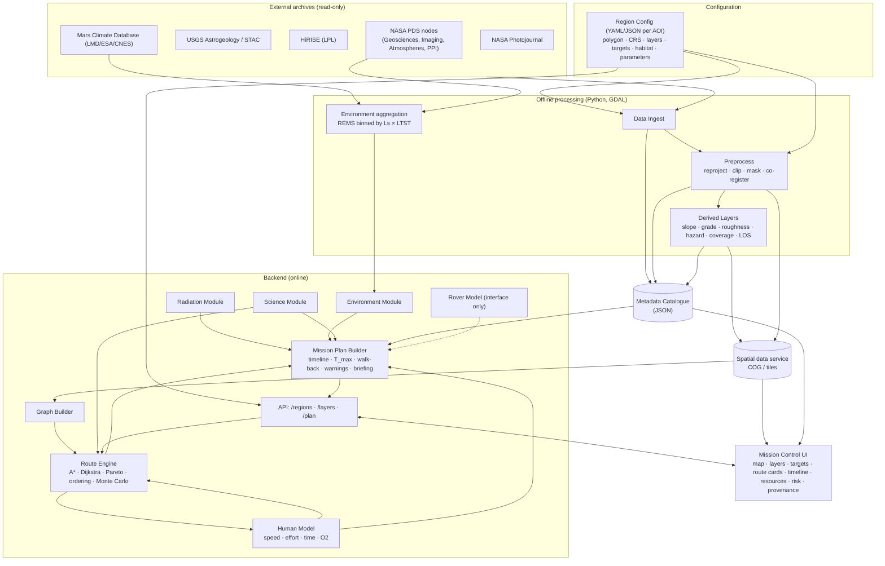
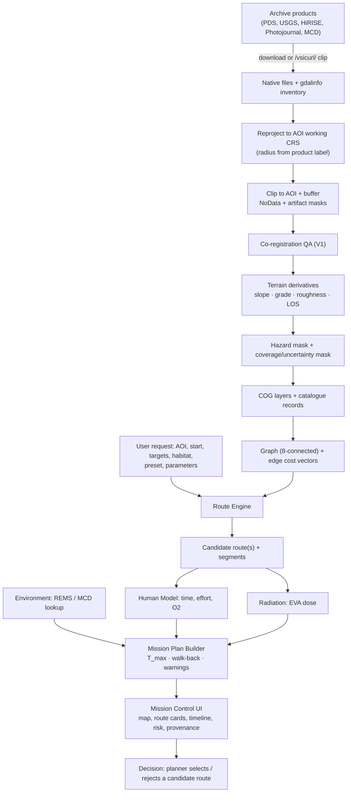
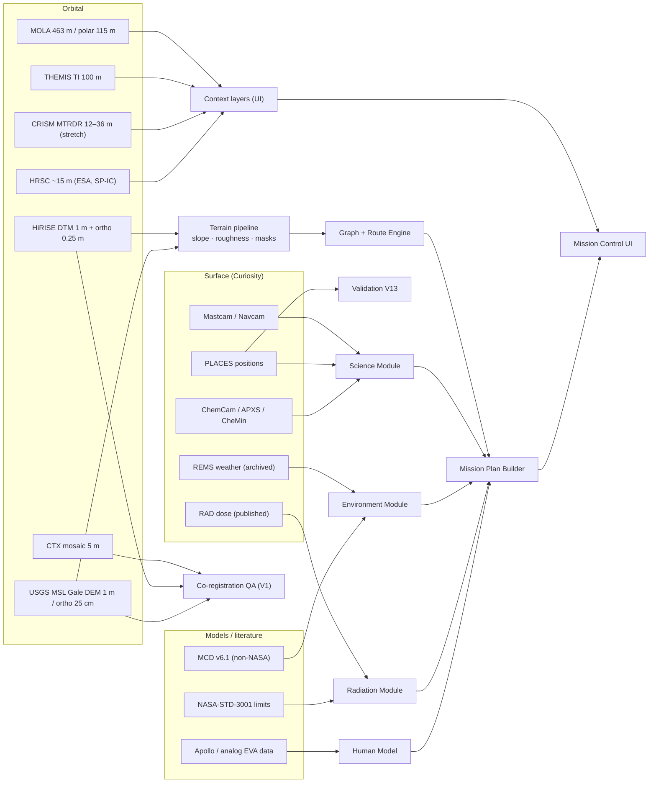
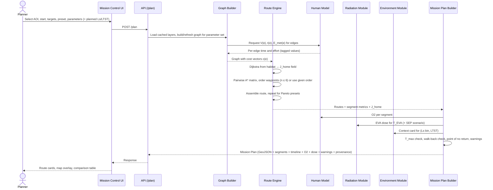
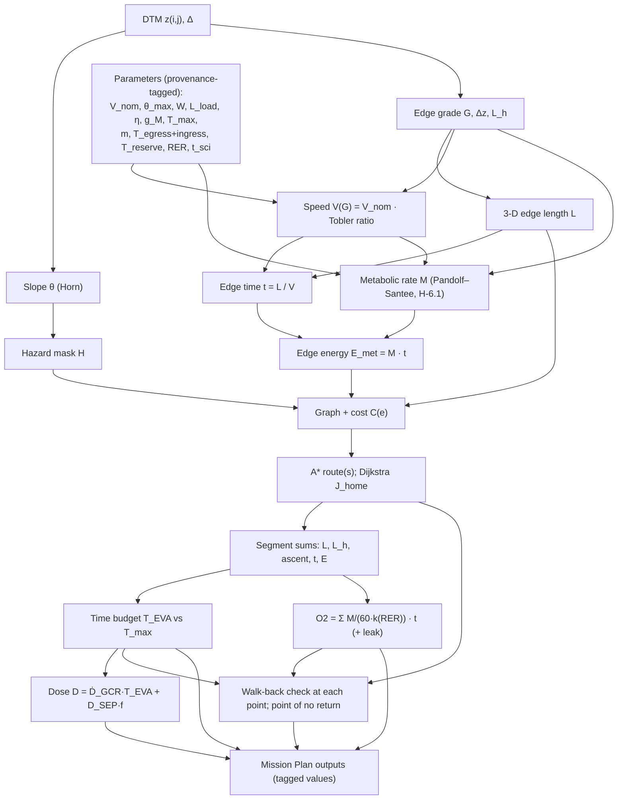
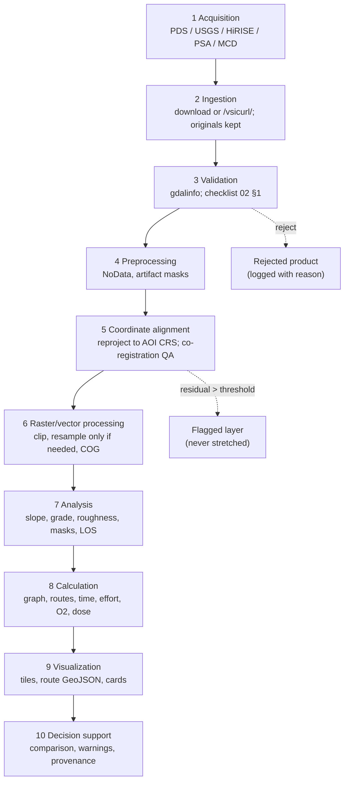
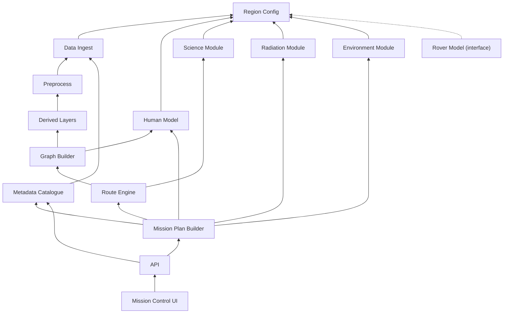
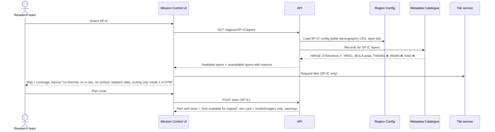
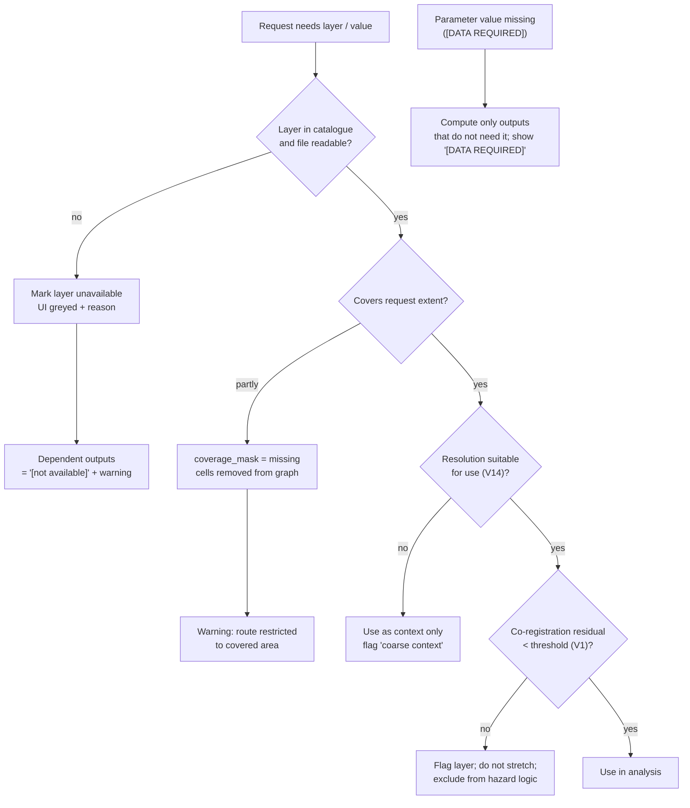

# Document control

| Item | Value |
|---|---|
| Document | MARSWALK_COMPLETE_SYSTEM_TECHNICAL_SPECIFICATION_v1.1 |
| Version / date | 1.1 · 14 Nov 2026 (supersedes v1.0 of the same day) |
| Owner | Research & Technical Validation (Alikhan) |
| Technical co-owners | Arthur (frontend, integration), Aikyn (backend, terrain processing, routing, deployment) |
| Status | **Authoritative system description. Not a validation report.** |
| Sources actually read for v1.1 | **KB v1.0** (13 Nov 2026): `00`–`06` in full. **Project documents:** `MIGRATION_REPORT.md`; `MARSWALK_Data_Verification_Report_v1.0.md` (DVR, 13 Nov — newest data audit); `MARSWALK_Spec_v2.0_Verification_Report.md` (VR); `MARSWALK_Data_Availability_Assessment_v0.1.md`; `MARSWALK_System_Spec_v2.0.md` (archived). **PRD:** "MARSWALK — Product Requirements (PRD) v1.0" (Claude Doc, 13 Nov; not in Project Knowledge) — source of MVP priorities P0/P1. **Team context:** project memory and project chats of 12–14 Nov 2026 (incl. the 14 Nov Mars Trek review). |
| Not read (and why) | `MARSWALK_Research_Technical_Dossier.docx` v0.1 — fully migrated into KB per `MIGRATION_REPORT` §C; `NASA Space Apps Challenge.pdf` — its rules are carried in `00` §10. |
| Precedence | KB file wins on method and parameters. **Exception:** where the DVR (newer, archive-checked) contradicts a KB data fact, the DVR value is used here and the KB file is corrected in the same release (see change log). The PRD wins on MVP priority (P0/P1/non-goal). Every such case is logged in §19. |
| Relationship to KB | This STS **consolidates** the KB into one system-level description. It does not replace the KB files: equations and parameters remain owned by `03`, datasets by `02`, citations by `04`, tests by `05`, status by `06`. Where this STS and a KB file disagree, the KB file wins and the disagreement must be logged in §19. |

## Change log v1.0 → v1.1

| # | Change | Reason / source |
|---|---|---|
| 1 | REMS archive coverage corrected to **sols 0–4709** (was Sol 1–4488); covers boxwork entry (sol 4534) | DVR §1 #12 (MSL Analyst's Notebook release table, 19 Mar 2026); PDS Atmospheres node page is stale |
| 2 | DTM vertical precision σ_z: literature value **EP = 7 cm** (was [DATA REQUIRED]) | DVR §1 #1 citing [Siebach2014]; still to be read from the PDS label |
| 3 | Boxwork elevation anchor **−3620 ± 50 m** (was [DATA REQUIRED]) | DVR §1 citing [Siebach2014] |
| 4 | HiRISE DTM bounding box, projection, format; alternative DTM `DTEEC_009149_1750_009294_1750_U01`; campaign may lie at the eastern end of the boxwork unit | DVR §1–§2 |
| 5 | Verification levels L0–L4 added; every GALE-BX product is L1–L2, none L3 | DVR §0 |
| 6 | MVP priority column (P0 / P1 / non-goal) added to the requirements register from the PRD; PRD performance targets added | PRD "Requirements", "Success metrics" |
| 7 | GCR 0.64 ± 0.12 mSv/day confirmed against Hassler 2014 Table 1 (Q-35 closed) | PRD Q8 (closed 13 Nov) |
| 8 | Distance measurement reclassified as stated team intent; Mars Trek WMTS (`EPSG:104905`) noted as candidate display basemap; Trek profile/distance tools weaken the "regional tools cannot" claim | Project memory; 14 Nov Mars Trek chat |
| 9 | Additional rover POV IDs PIA26560 (sol 4536), PIA26693 (sol 4671) | DVR §1 #10 |
| 10 | §19 register re-audited: 6 items closed or narrowed, 8 new items (PRD vs KB conflicts, duplicate file, alternative DTM) | This audit |
| 11 | Document control rewritten to list only sources actually read (v1.0 overstated that archived documents were consulted) | Correction |
| 12 | KB files `02`, `03`, `04`, `06` updated with items 1–4 and 7 | Single source of truth |

## How to read this document

**Cross-references.** "`03` §4.2" means section 4.2 of `03_MATHEMATICAL_MODELS.md`. Citation keys in square brackets (e.g. [Hassler2014]) resolve in `04_SCIENTIFIC_REFERENCES.md` §2.

**Implementation-status vocabulary** (applies to every function in this document):

| Status | Meaning in this STS |
|---|---|
| **IMPLEMENTED** | Verified as implemented (code exists and was observed running). |
| **PROTOTYPED** | Partially implemented or demonstrated. |
| **DESIGNED** | Technically specified (inputs, algorithm/equation, outputs) in the KB, but not implemented. |
| **PLANNED** | Intended future functionality; not technically specified, or explicitly marked Future [F]. |
| **UNVERIFIED** | Implementation *or* scientific correctness has not been confirmed. Used as a second qualifier, e.g. "DESIGNED · UNVERIFIED (science)". |

> **Status baseline (important).** The most recent status record in the Project Knowledge (`06` §1, 13 Nov 2026) states: *no data downloaded, no code, no validation executed.* The DVR (13 Nov) confirms that every GALE-BX product is at verification level L1–L2 and none at L3 (no file opened in GDAL). The hackathon build started 14 Nov 2026 09:00 local time; no build artefact, repository link or test result has been added to the Project Knowledge since. **Consequently, no function in this version of the STS is marked IMPLEMENTED or PROTOTYPED.** The team must update the status column of the Functional Requirements register (§15) as soon as code is demonstrated, and log the evidence (commit, screenshot, test ID) in `05` §5 and `06`.

**Data verification levels** (from the DVR §0; used in §3): **L0** claimed, no primary source · **L1** literature value · **L2** archive-confirmed (ID, extent, resolution read from an index, label or product page) · **L3** inspected (file or remote header opened with GDAL) · **L4** fit-for-use (L3 + AOI coverage on valid pixels, V1, V3).

**MVP priority** (from the PRD): **P0** — cannot submit without it · **P1** — only if P0 is done, cut from the bottom · **non-goal** — explicitly out of the hackathon scope.

**Evidence labels** (canonical definitions in `00` §9.1): [E] Established · [D] Data available · [MVP] buildable in 48 h · [R] Research needed · [F] Future · [TO BE VERIFIED] / [DATA REQUIRED] · [DECISION NEEDED]. Numeric outputs carry one of: `measured | derived | model | assumption | illustrative`.

**Worked examples** in §7 use **illustrative inputs** chosen only to demonstrate the arithmetic. They are not project parameters, not Mars measurements and not validation results.

**Terminology** (used consistently; see also `00` §13):

| Term | Meaning in MARSWALK |
|---|---|
| AOI | Area of interest — one bounded region configured for one planning/science scenario (GALE-BX, GALE-GC, SP-IC, SP-MH). |
| Region Config | Version-controlled YAML/JSON file that defines one AOI: polygon, working CRS, layer list, targets, habitat, parameters. |
| Layer | One georeferenced raster or vector product (source or derived) with a catalogue record. |
| Candidate route | A route computed by the Route Engine under stated assumptions. Never "safe route". |
| Preset | A named set of objective weights ("shortest", "least effort", "most certain", "terrain-only"). |
| Habitat | The configured safe-haven point (lander/habitat) used for walk-back and line-of-sight. |
| Effort index | Gravity-scaled Pandolf–Santee metabolic rate, used as a *relative* measure between routes. |
| Mission Plan | The stored result of one planning request: route scenario + timeline + resource profile + risk summary + provenance. |

# 1. System Overview

## 1.1 Project definition

MARSWALK is a **decision-support system for planning a single human extravehicular activity (EVA) on the surface of Mars**. It fuses data products from several NASA Mars missions into one hyperlocal, layered view of an AOI; derives terrain properties from elevation models; computes candidate walking routes between science targets on a documented cost surface; estimates time, effort, oxygen and radiation dose for each route; checks the route against an EVA time limit and a walk-back (return-to-habitat) constraint; and shows the provenance, resolution and uncertainty of every layer and every number. (`00` §4.)

It was conceived for the NASA Space Apps Challenge 2026 challenge *"Interplanetary Survival Guide: Martian Map"*, whose brief asks for a layered, integrated view of a Martian site or route that fuses several NASA science missions and helps a human explorer plan and conduct a safe Marswalk while doing new science (`00` §2).

MARSWALK is **not** a generic Mars globe, a GIS viewer, or a shortest-path calculator. Its core chain is:

**NASA dataset → scientific model → mathematical formulation → algorithm → system output → validation method.**

If any link of that chain is missing for a function, the function is labelled [R] or [F] and is not presented as working (`00` §4).

> **Naming conflict.** The Project description calls the project "ARES (working)"; all KB files use MARSWALK. This STS uses **MARSWALK** and logs the conflict as Q-01 in §19.

## 1.2 Mission and purpose

- Give mission planners, astronauts and science specialists **one place** where the evidence relevant to a specific EVA is co-registered, documented and comparable.
- Turn that evidence into **candidate routes with explicit costs**, not into opaque recommendations.
- Make **data limitations visible**: resolution, coverage gaps, acquisition age and uncertainty are first-class outputs, because "a route is only as reliable as the resolution, coverage, coordinate reference, age and uncertainty of its input layers" (`00` §4).

## 1.3 Problem statement

> How can heterogeneous Mars mission datasets be integrated into a transparent, multi-region decision-support system that helps mission planners and future surface explorers identify science targets and evaluate candidate traverses while explicitly accounting for spatial coverage, resolution, uncertainty and terrain risk? (`00` §7)

The gap MARSWALK addresses: existing public tools (NASA Mars Trek, USGS–NASA geologic maps, JMARS) are designed for regional/global browsing. The challenge asks for a single-EVA, hyperlocal view. **Partly checked (14 Nov team review):** Mars Trek already offers elevation profiles, distance measurement, a Curiosity traverse layer and named points of interest. The "how we differ" claim therefore must **not** say that regional tools lack profiles or distances; the defensible difference is the coupled EVA logic (time budget, walk-back, consumables, provenance and uncertainty on one hyperlocal AOI). JMARS capabilities remain **[TO BE VERIFIED]**.

Research questions RQ1–RQ5 (data integration, route feasibility, scientific utility, multi-region generality, transparency) are defined in `00` §7 and are the evaluation frame for this system.

## 1.4 Target users

| User | Primary task | Information need | Primary interface |
|---|---|---|---|
| Mission planner | Prepare an EVA; compare candidate routes | AOI overview, coverage, hazards, route cost, target value, uncertainty, time/O₂/dose budgets | Mission Control UI (tablet / planning display) |
| Astronaut / field explorer | Orient locally; reach the next waypoint | Local terrain, waypoint objective, distance, expected appearance (rover POV image), known hazards | Same UI; simplified field mode is PLANNED [F] |
| Science specialist | Select observations; prioritise targets | Geological context, imagery, spectral/chemical evidence, source metadata | Target catalogue and layer panels |

Source: `00` §6.

## 1.5 Operational scenarios

| ID | Scenario | Status |
|---|---|---|
| OS-1 | **Pre-EVA planning** in the habitat: choose AOI, objective, targets; generate and compare candidate routes; accept one Mission Plan. | DESIGNED |
| OS-2 | **Route comparison**: 3–5 Pareto alternatives compared on distance, effort, uncertainty, time, O₂ and dose. | DESIGNED |
| OS-3 | **Region switch**: load another AOI with a different dataset collection through its Region Config. | DESIGNED |
| OS-4 | **Changing-conditions re-plan** (e.g. different season/Ls, SEP scenario) with route recomputation. | PLANNED (stretch, `00` §4) |
| OS-5 | **In-EVA monitoring** (actual position/consumption vs plan). | PLANNED [F] — no telemetry input is specified anywhere in the KB. |
| OS-6 | **Field / HUD mode** for the astronaut. | PLANNED [F] (F-11) |

## 1.6 System boundaries

**Inside the system boundary**

- Ingestion, cataloguing, reprojection and clipping of archived NASA (and one ESA-partner, one LMD model) data products for configured AOIs.
- Terrain derivatives (slope, grade, roughness, masks, viewshed), cost surfaces, routing, metabolic/time/O₂/dose estimates, environmental context lookup, science-target scoring, uncertainty propagation, provenance tracking.
- A web-based Mission Control UI.

**Outside the system boundary** (explicitly not provided)

- **Real-time Mars weather or radiation data.** No real-time feed exists for any of our AOIs (`00` §9.2 rule 2; `02` §5.10).
- Certification of astronaut safety, traction or bearing capacity (`00` §9.2 rules 1, 6).
- Suit telemetry, crew biomedical monitoring, navigation positioning (GNSS does not exist on Mars; no localisation input is specified).
- Rover (vehicle) operations beyond a documented energy-model interface (`03` §7.4).
- Global-scale data processing: only the selected AOI is loaded (`01` §3).
- Walking routes **between** regions (e.g. Gale ↔ south polar). Multi-region means independent scenarios, never one traverse (`00` §5).

## 1.7 Core capabilities (summary)

| # | Capability | Owning module | MVP prio. (PRD) | Status |
|---|---|---|---|---|
| C1 | AOI selection via Region Config | Region Config / UI | P0 (R1) | DESIGNED |
| C2 | Layered map with provenance per layer | Mission Control UI + Metadata Catalogue | P0 (R1, R7) | DESIGNED |
| C3 | Terrain derivatives: slope, grade, roughness, hazard and coverage masks | Derived Layers | P0 (R1, R2) | DESIGNED |
| C4 | Line-of-sight to habitat | Derived Layers | P1 (R16) | DESIGNED (if time) · operational rule UNVERIFIED for Mars |
| C5 | Candidate route generation (A*) with presets | Graph Builder + Route Engine | P0 (R3) | DESIGNED |
| C6 | Pareto comparison of 3–5 routes | Route Engine | P1 (R10) | DESIGNED |
| C7 | Waypoint ordering (n ≤ 6) | Route Engine | P0 (R3) | DESIGNED · PRD: exact enumeration + user lock (D5 still open in `06`) |
| C8 | Time, effort index, O₂ estimate per segment | Human Model | P0 time/effort (R4); O₂ P1 (R11) | DESIGNED · UNVERIFIED (science) |
| C9 | EVA time budget, T_max check, walk-back / point of no return | Mission Plan Builder | P0 (R5) | DESIGNED · UNVERIFIED (science) |
| C10 | EVA radiation dose (GCR + additive SEP scenario) | Radiation Module | P1 (R12) | DESIGNED |
| C11 | Environmental context card (historical REMS + modelled MCD) and dust-season flag | Environment Module | P1 (R13) | DESIGNED |
| C12 | Science-target catalogue, value scoring, sampling plan, rover POV images | Science Module | P0 (R6) | DESIGNED |
| C13 | Monte Carlo uncertainty over DTM noise and parameters | Route Engine / Uncertainty | P1 (R14) | DESIGNED |
| C14 | Route briefing that restates only computed results | Mission Plan Builder / UI | P0 (R8) | DESIGNED (concept, `00` §4) |
| C15 | CV boulder/obstacle layer | Derived Layers | P1 (R18) | PLANNED (optional demo) · UNVERIFIED |
| C16 | Export (GeoJSON / CSV / PDF) | Mission Plan Builder | P1 (R15) | DESIGNED ("Could") |
| C17 | Rover energy model | Rover Model | non-goal | PLANNED — interface only, not MVP |

> **Priority conflict.** The PRD puts O₂ (R11), the radiation card (R12), the REMS card (R13), Monte Carlo (R14), Pareto presets (R10) and line-of-sight (R16) in **P1**, while `01` §9 marks them "Hackathon MVP ✅". This STS follows the PRD for priority and logs the conflict as Q-56.

# 2. System Architecture

## 2.1 Architectural principles

1. **Multi-region by configuration.** All AOI-specific facts (polygon, CRS, layers, targets, habitat, parameters) live in a Region Config; core algorithms are region-agnostic (`01` §4; `00` §5).
2. **Native data preserved.** Source files are stored untouched in their native CRS; all analysis happens on derived, reprojected copies with a recorded transform history (`01` §6, §8 step 2).
3. **Metric analysis only.** Distances and slopes are never computed in degrees or Web-Mercator-like projections (`01` §6).
4. **Every number is a tagged value** `{value, unit, source_tag, label}` (`01` §7).
5. **Deterministic, explainable algorithms.** No ML is required for routing (`06` §3); route scores are decomposable into their components (`01` §3).
6. **Separate physical models.** Human EVA consumables and rover energy are separate models and are never combined into one "fuel" (`00` §9.2 rule 3).
7. **Graceful degradation.** A missing layer does not crash the system; it is shown as unavailable and raises uncertainty (`01` §3).

## 2.2 Component overview

The KB names the following components (`01` §4). This STS maps the user-facing names requested for this specification onto them:

| STS name | KB component(s) | Responsibility | Candidate implementation (KB) | Status |
|---|---|---|---|---|
| Frontend | Mission Control UI | AOI selection, map, layer controls, target cards, route controls, timeline, resources, risk, provenance panel | Web app; **map library not chosen** | DESIGNED |
| Backend API | `GET /regions`, `GET /regions/{id}/layers`, `POST /plan` | Serve AOIs, layers, plans | **Framework not chosen** | DESIGNED |
| Region Config | Region Config | Per-AOI definition | Version-controlled YAML/JSON | DESIGNED |
| Data processing components | Data Ingest, Preprocess | Acquire, inventory, reproject, clip, mask | Python: GDAL ≥ 3.6, rasterio, numpy, geopandas, scipy / scikit-image; QGIS for QA | DESIGNED |
| GIS engine | Preprocess + Derived Layers + Spatial data service | Raster/vector operations, terrain derivatives, tiles | GDAL/rasterio; static object storage or tile service; COG files | DESIGNED |
| Metadata Catalogue | Metadata Catalogue | Provenance record per layer (schema `02` §2) | JSON/GeoJSON/CSV or lightweight DB | DESIGNED |
| Route optimization engine | Graph Builder + Route Engine | Graph, A*, Dijkstra cost-to-home, Pareto, waypoint ordering, Monte Carlo | Python (A*/Dijkstra on raster graph) | DESIGNED |
| Calculation engine | Human Model + Radiation Module + Mission Plan Builder | Time, effort, O₂, dose, T_max, walk-back, plan assembly | Python | DESIGNED |
| Environmental data module | Environment Module | REMS climatology lookup, MCD comparison, dust flag | Offline aggregation → lookup table | DESIGNED |
| Science module | Target catalogue + value model | Targets, scores, sampling plan, POV images | Region Config + catalogue | DESIGNED |
| Rover model | Rover Model | SOC balance (interface only) | — | PLANNED |
| CV obstacle layer | (part of Derived Layers) | Boulder/obstacle polygons from imagery | Not specified | PLANNED (optional) |

## 2.3 Overall architecture diagram

**Figure 1 — Overall system architecture**



*Solid arrows: designed data flow. Dashed arrow: documented interface not in MVP.*

## 2.4 Component descriptions

**Region Config.** One file per AOI. Holds the AOI polygon (lon/lat, Mars 2000 sphere), working CRS as a PROJ string, list of layer IDs with their source products, science targets with coordinates and evidence links, habitat location, default parameter set with provenance tags. Adding a region = adding a config and its processed layers; no algorithm code changes (`01` §4; `00` §5). **Gap:** no Region Config schema beyond this field list exists in the KB, and **no habitat location has been defined for any AOI** (§19, Q-12).

**Data Ingest.** Downloads or remotely reads (`/vsicurl/`) archive products; runs `gdalinfo` on every product and writes CRS, extent, pixel size, NoData, datum and body radius into the Metadata Catalogue; preserves untouched originals; rejects products with unknown georeferencing or unsuitable resolution (`01` §8 steps 2, 4).

**Preprocess.** Reprojects to the AOI working CRS, clips to AOI + route buffer, applies NoData and artifact masks, performs co-registration QA against 5–10 control features (`01` §8 steps 3–5).

**Derived Layers.** Computes slope (Horn), directional grade, 3-D step length inputs, roughness, hazard mask, coverage/uncertainty mask, viewshed to habitat, and — as research items — illumination and surface-material proxy (`03` §2). Outputs Cloud-Optimised GeoTIFFs (COG): `slope.tif`, `roughness.tif`, `hazard_mask.tif`, `coverage_mask.tif`, `los_to_hab.tif`, `cost.tif` (`01` §8).

**Metadata Catalogue.** One record per layer using the 14-field schema of `02` §2 (layer_id, mission/instrument, product_id, product_type, source_url, acquisition_time, spatial_resolution, coordinate_reference, processing_level, footprint/coverage, quality_flags, accuracy, transform_history, usage_terms). Feeds the provenance panel and the source tags of every computed number.

**Spatial data service.** Serves raster/vector tiles and AOI metadata to the UI; static object storage or a tile service (`01` §4).

**Graph Builder.** Converts valid cells into an 8-connected graph and attaches the edge cost vector **c(e) = [L, E_met, U, X]** (`03` §3.1).

**Route Engine.** A* for the scalarised objective; Dijkstra from the habitat for the cost-to-home field; weight sweep / ε-constraint for Pareto sets; brute-force waypoint ordering for n ≤ 6; Monte Carlo re-runs for uncertainty (`03` §3, §11).

**Human Model.** Speed–slope function, gravity-scaled Pandolf–Santee effort index, per-edge time and metabolic energy, O₂ consumption (`03` §4–§5, §7.1). Owned separately from the Rover Model.

**Radiation Module.** EVA dose from the RAD-measured GCR rate plus an additive SEP scenario; fraction of career limit; (research) altitude and terrain-shielding correction (`03` §8).

**Environment Module.** Lookup of REMS climatology by (Ls bin, LTST hour), MCD comparison values, dust-season flag; always labelled historical / model (`03` §9).

**Science Module.** Target catalogue, value model V_k, sampling-plan records, rover POV image references (`03` §10).

**Mission Plan Builder.** Assembles the Mission Plan: route geometry and segments, timeline, T_max check, walk-back feasibility and point-of-no-return marker, O₂ and dose summaries, warnings, provenance, random seed; produces the route briefing and exports (`01` §5).

**Mission Control UI.** Presents everything above; enforces the UI rule that every route summary shows active parameter values and provenance tags (`01` §2).

## 2.5 Integration between modules

| Producer | Consumer | Shared artefact | Contract |
|---|---|---|---|
| Region Config | Ingest, Preprocess, API, UI | AOI definition | YAML/JSON; PROJ string; layer IDs |
| Ingest / Preprocess / Derived | Metadata Catalogue | Catalogue record | `02` §2 schema |
| Preprocess / Derived | Spatial data service | COG rasters, vectors | Working CRS; NoData defined |
| Derived Layers | Graph Builder | slope, grade, roughness, hazard, coverage, LOS rasters | Same grid, same CRS, same extent |
| Graph Builder | Route Engine | Graph with cost vectors | c(e) = [L, E_met, U, X] |
| Human Model | Graph Builder / Route Engine | V(e), t(e), E_met(e) | Per-edge functions; parameters with provenance |
| Science Module | Route Engine, Plan Builder | Targets (coords, V_k, t_sci) | Region Config records |
| Route Engine | Mission Plan Builder | Route(s), segment metrics, J_home field | GeoJSON + arrays |
| Radiation / Environment | Mission Plan Builder | Dose, context card, flags | Tagged values |
| Mission Plan Builder | API → UI | Mission Plan | `POST /plan` response (§12) |

## 2.6 System-level data flow

**Figure 2 — System data flow (offline preparation vs online planning)**



**Offline** (before a session): steps A–I run once per AOI and are cached. **Online** (per request): steps J–Q run on the cached layers.

# 3. NASA Data Integration

## 3.1 Integration status statement

**No dataset is currently integrated.** As of the KB baseline, the data catalogue is a desk audit plus a 13 Nov source verification: *nothing has been download-verified, no file has been opened in GDAL, no no-data/artifact check has been run* (`02` header). In this section:

- "Footprint ✅" means the archive confirms the product covers the AOI (from archive pages or labels), **not** that MARSWALK has ingested it.
- Every dataset's **integration status** is therefore DESIGNED (processing specified), PLANNED (listed, processing not specified), or EXCLUDED (not meaningful for our AOIs).
- The DVR (13 Nov) grades every GALE-BX product at verification level **L1–L2; none is L3**. The audit workspace was blocked from the archive hosts (proxy 403); L3 must be produced on a team machine with the DVR's `verify_gale_bx.py` (Appendix A).

The acceptance checklist applied to every product (authoritative source, product ID, CRS/radius, resolution suitability, acquisition time, AOI coverage, artifacts, legal access, reproducibility) is defined in `02` §1.

## 3.2 Data source comparison table

**Table 1 — Data source comparison (primary AOI GALE-BX unless stated)**

| Source (mission / instrument) | Data type | Native spatial res. | Temporal nature | AOI coverage | Consuming module | Integration status |
|---|---|---|---|---|---|---|
| MRO HiRISE DTM DTEEC_001488_1750_001752_1750_U02 | Topography (stereo DTM) | 1 m grid (1.01 m/px); EP 7 cm | Single epoch (stereo pair) | GALE-BX ✅ bbox (L2); campaign-site coverage **P0 unproven** | Derived Layers, Graph Builder | DESIGNED |
| MRO HiRISE orthos PSP_001488_1750, PSP_001752_1750 | Optical | 0.25 m | Single epoch | GALE-BX ✅ | UI base layer, QA, CV (optional) | DESIGNED |
| USGS MSL_Gale_DEM_Mosaic_1m_v3 (HiRISE→CTX→HRSC→MOLA) | Topography (merged) | 1 m **grid**; effective res. coarser where filled | Composite | Gale ✅ | Derived Layers (fallback/extension) | DESIGNED |
| USGS MSL_Gale_Orthophoto_Mosaic_25cm_v3 | Optical (merged) | 0.25 m | Composite | Gale ✅ | UI base layer, co-registration | DESIGNED |
| MRO CTX — Murray Lab Global CTX Mosaic v1 | Optical context | 5 m | Composite | 88°S–88°N ✅ | UI context, V1 co-registration | DESIGNED (context) |
| MGS MOLA MEGDR 128 ppd | Topography (regional) | ~463 m | Composite | Global ⚠ context | UI context only | PLANNED (context) |
| MGS MOLA polar MEGDR megt_s_512 + megc_s_512 | Topography + counts | ~115 m | Composite | SP-IC ⚠ context | SP-IC context; counts → mask | PLANNED |
| Mars Odyssey THEMIS TI mosaic (USGS, quantitative) | Thermal inertia | 100 m | Composite | ±60° ✅ (tile name TBV); SP-IC ❌ | UI context layer; material proxy cross-check | DESIGNED |
| MRO CRISM MTRDR | Spectral | 12–36 m | Per scene | 🟡 footprint over campaign site TBV | UI stretch layer | PLANNED (stretch) |
| MSL Mastcam / Navcam | Rover POV imagery | cm (ground) | Per sol | GALE-BX ✅, GALE-GC ✅ | Science Module (waypoint images) | DESIGNED |
| MSL PLACES localizations | Rover positions | point | Per sol | Gale ✅ | AOI definition, targets, V13 | DESIGNED |
| MSL ChemCam / APXS / CheMin | In-situ chemistry | point | Per sample | Gale ✅ | Science Module (evidence) | DESIGNED (as evidence links) |
| MSL REMS | Surface weather | point (rover) | Hourly blocks; archived sols 0–4709 (L2) | Gale ⚠ historical; covers boxwork entry (sol 4534) | Environment Module | DESIGNED |
| MSL RAD | Radiation dose | point (rover) | Continuous; published averages; RDR metadata updated 10 Mar 2026, sol range not checked | Gale ⚠ historical | Radiation Module | DESIGNED (published values) |
| Mars 2020 MEDA | Surface weather | point | Archived | Jezero only ❌ | — | EXCLUDED |
| Mars Express HRSC orbit 25449 (ESA partner) | Optical (+ DTM TBV) | ~15 m image | 27 Feb 2024 | SP-IC ✅ imagery | SP-IC context | PLANNED |
| Mars Climate Database v6.1 (LMD/ESA/CNES; non-NASA) | Climate model | global grid | Climatology | all ⚠ model | Environment Module (comparison) | DESIGNED |
| MGS TES / MRO MCS | Dust/atmosphere climatology | global | Historical | all ⚠ | Environment Module (dust season) | PLANNED |
| Apollo / NASA analog EVA literature | Human performance | — | — | proxy | Human Model parameters | DESIGNED (as parameters) |
| NASA-STD-3001 / OCHMO | Radiation limits | — | — | all | Radiation Module | DESIGNED |

Sources: `02` §4–§5; DVR §1. ✅ footprint confirmed from archive; 🟡 product exists for region, exact footprint unconfirmed; ⚠ available with routing-relevant limitation; ❌ not available / not meaningful.

**Challenge requirement "≥ 3 distinct data types"** (`00` §2): for GALE-BX the minimum layer set is **optical (HiRISE ortho) + topography (HiRISE DTM) + thermal (THEMIS TI)**, plus rover POV images and a REMS/RAD context card (`02` §8). Spectral (CRISM) is a stretch layer because its footprint over the campaign site is unconfirmed.

## 3.3 NASA data integration diagram

**Figure 3 — NASA data integration: sources → processing → consuming modules**



## 3.4 Per-source specification

Each entry follows the fields required for this STS. "From label" means the value must be read from the product's PDS/GeoTIFF label at ingest and recorded in the catalogue; it is not yet known to the project.

### 3.4.1 HiRISE DTM and orthoimages — GALE-BX

- **Mission / instrument:** Mars Reconnaissance Orbiter (MRO) / HiRISE.
- **Product:** DTM **DTEEC_001488_1750_001752_1750_U02**; stereo pair PSP_001488_1750 / PSP_001752_1750 (PSP_001752_1750 is the source of NASA boxwork image PIA26306). Project name MSL_TRAVERSE_GAP_1; producer USGS. [HiRISE-DTM-BX]
- **Data type:** digital terrain model + orthorectified images.
- **Spatial resolution:** DTM 1.01 m/px on a 1 m grid; orthos 0.25 m. Post spacing ≈ 4× image pixel; relative vertical precision "tens of centimetres"; 25 cm images resolve objects ~75–83 cm; resolvable landforms typically 10–20 pixels. [HiRISE-About; USGS-STAC]
- **Vertical precision:** expected precision **EP = 7 cm** (0.2-px matching, Kirk et al. 2008 method) as reported for this DTM by [Siebach2014] (DVR §1 #1) — literature value (L1), still to be confirmed from the PDS label; artifacts of 0.5–1 m dominate EP and are masked separately.
- **Temporal resolution:** single stereo epoch. Acquisition dates: **from label [TO BE VERIFIED]**.
- **CRS:** equirectangular, MOLA-tied, aeroid elevation (DVR, from HiRISE `DTMCUMINDEX.TAB`); body radius **from label**. Centre −4.83°, 137.3°E. **Bounding box −4.9488° … −4.7206°, 137.2390° … 137.3540°E** (13,375 × 6,736 px). Elevation range −4485.57 … −2977.08 m. **Bounding box ≠ valid-data footprint**; the stereo-valid area is narrower and unknown until L3.
- **Format:** PDS3 `.IMG` (DTM); orthos PDS3 `.JP2/.IMG`: `PSP_001488_1750_RED_A_01_ORTHO` (389 MB), `PSP_001752_1750_RED_A_01_ORTHO` (371 MB), 1 m `_RED_C_` versions (~35 MB, adequate for display tiles), colour `PSP_001752_1750_IRB_C_01_ORTHO` (narrow central strip only). DTM 360 MB.
- **Coverage:** GALE-BX bbox ✅ (L2); inside both USGS MSL mosaics. The orbit-mapped boxwork of [Siebach2014] (image centres 137.288–137.329°E, 4.846–4.901°S) lies inside the bbox. **Open P0:** whether the 2025–26 Curiosity campaign (sols 4534–4805+, Altadena → Valle de la Luna → Nevado Sajama) lies on **valid** DTM pixels. Evidence for a miss: the boxwork extends ~14 km **west** of the rover traverse (Siebach et al., LPSC 2026), so the rover worked at the unit's **eastern** end, while the DTM bbox ends at 137.354°E. An alternative USGS DTM, **`DTEEC_009149_1750_009294_1750_U01`** (centre −4.79°, 137.4°E), covers terrain to the east (needs its own L2–L3 audit). GALE-GC overlap 🟡.
- **Information provided:** elevation → slope, grade, roughness, viewshed; ortho → visual base layer, manual/CV obstacle checks of objects > ~1 m.
- **Consumer:** Preprocess → Derived Layers → Graph Builder; UI base layer.
- **Processing:** `gdalinfo` inventory → reproject to local equirectangular → clip → artifact mask (V3) → Horn slope at native ~1 m and smoothed 3–5 m → roughness → hazard/coverage masks.
- **Elevation anchor:** boxwork interval at **−3620 ± 50 m** relative to the geoid [Siebach2014], consistent with the DTM z range; ~1 km above the modern crater floor (Siebach et al., LPSC 2026).
- **Limitations:** README warns of "box" artifacts with **0.5–1 m** vertical offsets, CCD seams and faceted zones where terrain is "not trustworthy" (must be masked) [HiRISE-README-BX]. Absolute accuracy vs MOLA ±100 m horizontal, ±1.3 m vertical (irrelevant for slope; relevant for cross-product alignment) [USGS-STAC]. Boxwork ridge height 1–2 m is comparable to the artifact size → ridge-scale slopes unreliable (`02` §6).

### 3.4.2 USGS MSL Gale merged DEM (1 m) and orthophoto mosaic (25 cm)

- **Mission / instrument:** merged product (HiRISE → CTX → HRSC → MOLA priority) by USGS Astrogeology. [USGS-MSL-DEM; Calef2016]
- **Data type:** DEM mosaic; orthophoto mosaic (grayscale; colour COG variant).
- **Spatial resolution:** DEM 1 m **grid** — "1 m grid ≠ 1 m data": where filled by CTX/HRSC the effective resolution is much coarser; **no per-pixel source mask found [TO BE VERIFIED]**. Ortho 0.25 m.
- **Temporal:** composite of multiple epochs.
- **CRS:** equirectangular, sphere R = 3,396,190 m (from label).
- **Extent:** DEM lat −5.098652° … −4.129605°, lon 137.124167° … 137.680559°E. Ortho lat −5.2495° … −4.0686°, lon 137.0947° … 137.8539°E. The GALE-BX DTM centre lies inside both.
- **Format / size:** GeoTIFF; DEM 3.6 GB; ortho 23 GB grayscale; colour COG `MSL_Gale_HiRISE-LRGB_78quads_sharp_cog.tif` ~1 GB. **Clip remotely** with `gdal_translate -projwin … /vsicurl/<url>`.
- **Consumer:** Derived Layers (fallback where HiRISE-sourced), UI base layer, V1 co-registration.
- **Limitations:** accuracy set by MOLA tie (~100 m horizontal, ~1 m vertical); USGS's suggested citation contains a typo ("Orthophoto Mosaic" for the DEM).

### 3.4.3 CTX — Murray Lab Global CTX Mosaic v1

- **Mission / instrument:** MRO / Context Camera (CTX); mosaic by Murray Lab. [Dickson2024]
- **Data type:** optical context mosaic. **Resolution:** 5 m. **Coverage:** 88°S–88°N (all three AOIs ✅). **Temporal:** composite.
- **CRS / format:** GeoTIFF tiles of 4° × 4° (murray-lab.caltech.edu/CTX/V01/tiles/); PDS4 bundle `mars_mro_ctx_globalmosaicv01_murraylab_2023`; tile name for −4.8°, 137.3°E **L0 [TO BE VERIFIED]**. Absolute errors < 200 m (Murray Lab) — must be co-registered to the DTM (V1).
- **Consumer:** UI context layer; control features for V1 co-registration.
- **Limitations:** too coarse for walk-scale slope or obstacle analysis.

### 3.4.4 MOLA

- **Mission / instrument:** Mars Global Surveyor / Mars Orbiter Laser Altimeter.
- **Products:** global MEGDR 128 ppd (MGS-M-MOLA-5-MEGDR-L3-V1.0), ~463 m at equator; polar **megt_s_512** (topography) and **megc_s_512** (observation counts), ~115 m. (Earlier drafts wrongly listed megc as topography — corrected, `02` §5.4.)
- **CRS:** polar MEGDR scaled on a **3376.2 km** sphere, not 3396.19 km (~0.59 % difference, ~6 m per km of route) → radius from each label [MOLA-polar-label].
- **Format:** PDS (polar labels PDS4 `.xml`).
- **Consumer:** UI regional context only. Counts → mask of interpolated pixels.
- **Limitations:** cannot support walk-scale slope; "documented south-polar coverage gaps" claimed in earlier drafts is **Unconfirmed**.

### 3.4.5 THEMIS thermal inertia

- **Mission / instrument:** Mars Odyssey / THEMIS; USGS quantitative TI mosaic. [USGS-THEMIS; Fergason2006; Edwards2011]
- **Data type:** thermal inertia (TIU). **Resolution:** 100 m. **Coverage:** ±60° only (GALE-BX, GALE-GC ✅; SP-IC ❌ — not produced poleward of 60°).
- **Temporal:** composite mosaic. **CRS / format:** ISIS3 / GeoTIFF, 32-bit, J m⁻² K⁻¹ s⁻½; 24 tiles of 30° × 60°. Gale falls in the **30S120E** tile by the tiling scheme (product L2, tile file name L0). Across the DTM bbox: ~68 × 135 pixels; one pixel ≈ 7–20 boxwork hollows.
- **Values (literature):** layered sulfate unit 355 ± 38 TIU; Murray formation 320–403 TIU; no separate boxwork value [Fraeman2016]. Absolute accuracy ~20 % → unit differences only marginally separable.
- **Consumer:** UI context layer ("coarse context" flag on every cell); cross-check for the surface-material proxy.
- **Limitations:** thermal inertia is not instantaneous surface temperature and not traction; never used as a per-cell hazard. **Tile-name conflict:** `02` §4 names tile "30S120E" (0–30°S, 120–180°E, appropriate for Gale at 137°E), while the `04` reference URL points to a "30s060e" tile (§19, Q-20).

### 3.4.6 CRISM

- **Mission / instrument:** MRO / CRISM; MTRDR (MRO-M-CRISM-5-RDR-MPTARGETED-V1.0; ODE MROCR_4001).
- **Resolution:** 12–36 m (scenes used by [Fraeman2016]: HRL0000BABA 36 m; FRT0000B6F1, FRT0001BBA1 18 m; ATO00021C92, ATO0002EC79, ATO00038AA7 12 m).
- **Coverage:** 🟡 — footprint over the 2025–26 site **[TO BE VERIFIED in ODE]**; SP-IC ⚠ seasonal ice.
- **Consumer:** optional UI spectral stretch layer.
- **Limitations:** even 12 m does not resolve 5–9 m ridges → unit-scale context only; atmospheric correction and spectral ambiguity.

### 3.4.7 MSL rover imagery, positions and chemistry

- **Mastcam / Navcam** (PDS Imaging; Photojournal): cm-scale ground imagery. PDS releases: R40 sols 4489–4612 (5 Dec 2025), R41 sols 4613–4709 (17 Mar 2026), R42 scheduled 3 Aug 2026 (range not checked). Identified: PIA26552 (boxwork Mastcam), PIA26560 (sol 4536), PIA26693 (sol 4671), sol 4611 Navcam, PIA26696 (Nevado Sajama 360°, sols 4714–4741) for GALE-BX; credit NASA/JPL-Caltech/MSSS; PIA19161, PIA19921, PIA19926 for Garden City. Consumer: Science Module (waypoint POV images). Limitation: camera geometry and image-to-map registration must be checked; credits/PIA IDs recorded.
- **PLACES** (doi:10.17189/1520397), SPICE `msl_surf_rover_loc_*`, Analyst's Notebook: rover positions per sol. Product L2; **coverage of sols 4534–4805 not confirmed (L0)** — this is the critical input for the P0 footprint test (DVR §2.3). Consumer: AOI definition (P0 check), target coordinates, Garden City coordinates, V13 plausibility overlay. Limitation: rover traverse is not ground truth for human mobility.
- **ChemCam / APXS / CheMin** (PDS Geosciences): point chemistry/mineralogy. R41: CheMin EDR/RDR to sol 4709; ChemCam RDR for sols 4613–4709 delayed. Consumer: Science Module evidence links. Limitation: applies only at sampled locations.

### 3.4.8 REMS (Rover Environmental Monitoring Station)

- **Products:** MSL-M-REMS-2-EDR, -3-TELRDR, MODRDR, ENVRDR (PDS Atmospheres). [PDS-REMS]
- **Measured:** air and ground temperature, pressure, humidity, wind, UV. **Spatial:** one point (the rover).
- **Temporal:** hourly 5-min blocks at 1 Hz plus extra 60-min blocks; archived with months of delay. **Released sols 0–4709** per the MSL Analyst's Notebook release table (updated 19 Mar 2026; DVR §1 #12, L2). The PDS Atmospheres node page still lists Sol 1–4488 (22 Mar 2025) and is stale; the v1.0 STS and KB `02` followed the stale page (corrected in v1.1). PDS4 release `msl_rems-20260803` exists, range not checked.
- **Consumer:** Environment Module (offline aggregation into a lookup table).
- **Processing:** pressure normalised hydrostatically for the > 400 m rover climb; binned by Ls × LTST (`03` §9).
- **Limitations:** single point at the rover; historical, not real-time. Released data reach sol 4709, i.e. the first ~175 sols of the boxwork campaign (entry sol 4534) are covered; sols 4710–4805+ depend on later releases (Q-22).

### 3.4.9 RAD (Radiation Assessment Detector)

- **Products:** MSL-M-RAD-2-EDR-V1.0, MSL-M-RAD-3-RDR-V1.0 (PDS PPI). [Hassler2014; Guo2021]
- **Use in MARSWALK:** **published** dose rates (not raw RDR processing): GCR 0.64 ± 0.12 mSv/day (Aug 2012–Jun 2013); solar-cycle range 0.25–0.95 mSv/day; SEP event doses (2017: 418 µGy Si; May 2024: 8.1 mGy). Values in `03` §8.
- **Spatial / temporal:** point at Gale; historical.
- **Consumer:** Radiation Module.
- **Limitations:** RAD "mSv" is LET-based dose equivalent; NASA limits are effective dose → comparison is an approximation. No surface radiation measurement exists at SP-IC.

### 3.4.10 HRSC (ESA partner) — SP-IC

- Mars Express / HRSC, orbit 25449 (27 Feb 2024), image ~15 m/px; DTM resolution not published; PSA product ID **[TO BE VERIFIED]** [DLR2024]. Consumer: SP-IC context. Too coarse for walk-scale slope. Listed as ESA (Space Agency Partner) data in the submission.

### 3.4.11 Mars Climate Database v6.1 (non-NASA)

- LMD/ESA/CNES GCM climatology with dust scenarios; global grid; **not a forecast**; v6.2 presented 2026; licence and v6.2 status **[TO BE VERIFIED]** [Millour2022]. Consumer: Environment Module comparison values. Must be cited separately from NASA data.

### 3.4.12 Portals used for display or orientation only

- **NASA Mars Trek** (trek.nasa.gov/mars): WMTS tile services in `EPSG:104905` (Mars 2000 geographic) are a **candidate display basemap** for regional/global zoom under MARSWALK's own HiRISE layers; Curiosity traverse and points-of-interest layers help sketch science points. Trek tiles are display products, **never** an input for slope or routing; list Trek as a visualisation tool, not as a dataset; Trek screenshots carry NASA interface/branding (submission rule). Tile loading from the project domain and coordinate agreement are **[TO BE VERIFIED]** (14 Nov team review).

### 3.4.13 Datasets considered but excluded or deferred

- **MEDA (Perseverance):** Jezero only — not our AOIs.
- **OMEGA (Mars Express):** candidate only in the v0.1 dossier; no product specified.
- **TES/MCS dust records:** referenced for the dust-season rule [Smith2019]; no product ingestion specified → PLANNED.
- **SP-IC thermal inertia:** THEMIS TI mosaic not produced poleward of 60°; TES TI (Putzig & Mellon 2007) unconfirmed.

## 3.5 Per-AOI data sufficiency

| AOI | Distinct verified categories with local coverage | Feasibility |
|---|---|---|
| GALE-BX | ≥ 5: optical, topography, thermal, rover POV, chemistry (spectral 🟡) | **HIGH** (subject to P0) |
| GALE-GC | thermal, POV, chemistry ✅; optical/topography need coordinate check | MEDIUM-HIGH as science stop |
| SP-IC | 3 (optical, topography, seasonal time series), two from the same imaging family; thermal ❌, in-situ ❌ | MEDIUM for mapping, LOW for safety-aware routing |
| SP-MH | not assessed for MVP | Future |

Source: `02` §4, §7. Note the challenge rule that "three styles of one dataset do not count" (`00` §2) puts SP-IC at risk of not meeting the ≥ 3 data-type requirement.

# 4. Interactive Mars Map

## 4.1 Role of the map

The map is the spatial foundation of the Mission Control UI: it presents co-registered layers, targets, candidate routes and data-quality information for **one AOI at a time**. It does not perform analysis itself; it displays outputs of the Derived Layers, Route Engine and Mission Plan Builder and sends user selections (points, targets, presets) to the API (`00` §6; `01` §2).

**Implementation note.** The map library is **not chosen** ("map library chosen by implementation team", `01` §4). Behaviour below is specified independently of the library.

## 4.2 Map functions

**Table 2 — Map functions and status**

| Function | Behaviour | Data / module | Status |
|---|---|---|---|
| Base map | AOI loads with the highest-resolution available optical layer (HiRISE / MSL 25 cm ortho for Gale) over a CTX 5 m context layer; Mars Trek WMTS (`EPSG:104905`) is a candidate regional basemap for display only | Spatial data service | DESIGNED (Trek basemap: candidate, TBV) |
| High-resolution imagery | 0.25 m ortho; colour COG where available; displayed with acquisition date and resolution | HiRISE / USGS mosaic | DESIGNED |
| Elevation model | DTM rendered as colour-ramped elevation with legend in metres (MOLA datum) | Derived Layers | DESIGNED |
| Shaded relief | Hillshade from DTM; also used for artifact QA (V3). Sun-geometry-specific shading for planned local time is research | Derived Layers | DESIGNED (QA hillshade) · illumination [R] |
| Terrain overlays | Slope, roughness, hazard mask, coverage/uncertainty mask, viewshed-to-habitat | Derived Layers | DESIGNED |
| Geological information | Science-target markers with rationale; published unit/context information as text and links; CRISM stretch layer; USGS/NASA geologic map as context | Science Module; literature | DESIGNED (targets) · geologic-map layer PLANNED (no product specified) |
| Environmental layers | Environmental **context card** (not a map layer): REMS climatology, MCD comparison, dust-season flag, radiation summary | Environment / Radiation Modules | DESIGNED |
| Thermal layer | THEMIS TI 100 m, flagged "coarse context" | Preprocess | DESIGNED |
| Coordinate display | Cursor lon/lat (planetocentric, °E) and elevation readout | UI + DTM | PLANNED — not specified in KB or PRD (§19, Q-25) |
| Distance measurement | User-drawn line → metric length computed in AOI working CRS (never degrees); optional great-circle check | UI + backend | PLANNED — stated team intent ("distances between points, travel time" among planned map functions, project memory); not in KB or PRD (Q-25) |
| Zoom and navigation | Pan/zoom constrained to AOI extent; tiles only for the AOI | UI + tile service | DESIGNED (AOI-only loading, `01` §3) · controls PLANNED |
| Layer management | Toggle, opacity, legend, metadata per layer (F-02) | UI + Metadata Catalogue | DESIGNED |
| Provenance panel | Mission, instrument, product ID, observation date, resolution, CRS, source URL per layer (F-03) | Metadata Catalogue | DESIGNED |
| Region selection | Choose a configured AOI (F-01) | Region Config | DESIGNED |
| Points of interest | Science targets: coordinates, objective, evidence, confidence, POV image (F-04, F-09) | Science Module | DESIGNED |
| Route visualization | Candidate route polyline(s), colour by preset; segment highlighting by cost component; point-of-no-return marker; waypoints numbered in visiting order | Mission Plan Builder | DESIGNED |
| Resolution display | Per-layer native resolution and feature-scale warnings (`02` §6) | Metadata Catalogue | DESIGNED (V14) |
| Coverage display | No-data areas and per-layer coverage % (V15) | coverage_mask | DESIGNED |

## 4.3 Layer stack (GALE-BX, designed)

| Order (top → bottom) | Layer | Native res. | Label |
|---|---|---|---|
| 1 | Candidate routes, waypoints, point-of-no-return marker | — | model output |
| 2 | Science targets | point | derived from literature / rover data |
| 3 | Hazard mask (+ CV obstacles, optional) | 1 m | derived (+ model for CV) |
| 4 | Coverage / uncertainty mask | 1 m | derived |
| 5 | Viewshed to habitat | 1 m | derived; operational heuristic [R] |
| 6 | Slope / roughness (one at a time) | 1 m (+ 3–5 m smoothed) | derived |
| 7 | THEMIS TI | 100 m | measured (coarse context) |
| 8 | CRISM (stretch) | 12–36 m | measured (context) |
| 9 | Elevation / shaded relief | 1 m | measured / derived |
| 10 | HiRISE / MSL ortho | 0.25 m | measured |
| 11 | CTX context | 5 m | measured |

## 4.4 How the map communicates with other modules

| Direction | Message | Counterpart |
|---|---|---|
| Map → API | AOI id on region selection | `GET /regions/{id}/layers` |
| API → Map | Tile URLs + catalogue metadata per layer | Spatial data service, Metadata Catalogue |
| Map → API | Start point, ordered or unordered targets, habitat, preset, parameters | `POST /plan` |
| API → Map | Route GeoJSON + segments[] + timeline + O₂ + dose + warnings[] + provenance | Mission Plan Builder |
| Map → Science Module (via config) | Target selection | Target catalogue |
| Map (local) | Layer toggle/opacity; no backend call | — |

**Coordinate rule for interaction.** A clicked point is captured in display coordinates, converted to lon/lat (Mars 2000 sphere) and then to the AOI working CRS on the backend; points may fall in a hazard or no-data cell. **PRD edge story:** a target placed outside DTM coverage or in an artifact zone is **refused with the reason** — a data gap is never treated as safe terrain. Whether a point in a slope-restricted cell is refused or snapped to the nearest valid node is still open (Q-26).

# 5. Terrain Analysis and Hazard Detection

All terrain analysis runs on an elevation grid $z(i,j)$ with cell size $\Delta$ (m) in the AOI's local metric projection (`03` §2). Owning module: **Derived Layers**. Status of the whole section: **DESIGNED**; nothing has been computed on real data yet.

## 5.1 Input data

| Input | Product | Requirement |
|---|---|---|
| Elevation | HiRISE DTM (1 m) or MSL 1 m DEM where HiRISE-sourced | Reprojected to working CRS; artifact polygons masked |
| Imagery | HiRISE / MSL 0.25 m ortho | For QA, manual obstacle polygons, optional CV |
| Thermal inertia | THEMIS TI 100 m | Context only |
| Habitat location | Region Config | **[DATA REQUIRED]** — not defined for any AOI |

## 5.2 Slope

Horn (1981) 3×3 finite differences [Horn1981] with neighbourhood

$$\begin{matrix} a & b & c\\ d & e & f\\ g & h & i\end{matrix}$$

$$\frac{\partial z}{\partial x}=\frac{(c+2f+i)-(a+2d+g)}{8\Delta},\qquad \frac{\partial z}{\partial y}=\frac{(g+2h+i)-(a+2b+c)}{8\Delta}$$

$$\theta=\arctan\sqrt{\left(\frac{\partial z}{\partial x}\right)^2+\left(\frac{\partial z}{\partial y}\right)^2}$$

- **Output:** `slope.tif` (degrees), computed at native ~1 m **and** at a smoothed 3–5 m baseline (`01` §8 step 6).
- **Sign note:** the sign of ∂z/∂y depends on row order; in polar stereographic "north" ≠ "up". Magnitude θ is unaffected; aspect is.
- **Status:** DESIGNED · method [E] · validation V2 (Horn vs manual profiles on 5 transects).

## 5.3 Elevation change and directional grade

Effort depends on climbing vs descending, so routing uses the **signed** grade along each graph edge, not the cell slope:

$$G_{edge}=\frac{z_{to}-z_{from}}{L_h}\times 100\ [\%]$$

with $L_h$ the horizontal step length ($\Delta$ or $\Delta\sqrt2$). Cumulative ascent and descent along a route are the sums of positive and negative $\Delta z$ over its edges (reported per segment; DESIGNED as part of the per-segment breakdown, `03` §4.4).

## 5.4 Surface roughness

$R(x)$ = standard deviation of $z$ in a $k\times k$ window ($k\in\{3,5\}$) after removing a least-squares local plane (detrended). A terrain ruggedness index (TRI) is an accepted alternative [E] (`03` §2). Output `roughness.tif` (m). **Caution:** at 1 m post spacing with 0.5–1 m artifacts, roughness partly measures DTM noise; artifact-masked cells must be excluded.

## 5.5 Terrain obstacles and hazardous areas

**Hazard mask** (`03` §2):

$$H(x)=\begin{cases}1 & \text{if } \theta(x)>\theta_{max}\ \text{or } x\in \text{mapped obstacle polygons}\\ 0 & \text{otherwise}\end{cases}$$

- $\theta_{max}$ is a configurable parameter: default 15° (< 10° preferred), alternative 20° — both **lunar analogs [R]** (`03` §5).
- **Edge case (PRD R3):** when no feasible route exists, the blocking constraint is named; there is never a straight-line fallback.
- **Mapped obstacles:** manually digitised or CV-detected boulder/scarp polygons from the 0.25 m ortho. CV detection is PLANNED (optional); manual polygons are DESIGNED.
- **Scale mismatch:** the 15° limit was derived on LOLA 5 m/px slopes; 1 m DTM slopes are steeper, so applying it to native 1 m slope over-restricts. Which slope raster (1 m or 3–5 m smoothed) feeds $H$ is **not decided** (§19, Q-14).
- Hazards are marked **only where data support them**; unknown terrain is not hazard-free — it is handled by the coverage/uncertainty mask (`00` §9.2 rule 9).

## 5.6 Coverage and uncertainty mask

Per cell, per layer: `native` / `resampled-coarser` / `missing`; THEMIS cells flagged "coarse context" everywhere; artifact-masked DTM cells flagged (`01` §8 step 7). Output `coverage_mask.tif`. Used by the Graph Builder (node validity) and as the uncertainty cost term $U$.

## 5.7 Traversability, safe and restricted zones

MARSWALK defines **traversability** as "estimated ability to move through terrain under stated assumptions, not a safety guarantee" (`00` §13). The designed zoning is:

| Zone | Rule | Graph treatment |
|---|---|---|
| Restricted | $H=1$ (slope > θ_max or mapped obstacle) | Node removed |
| No data / artifact | coverage = missing, or artifact polygon | Node removed per `03` §3.1 — **conflicts with PRD R2** ("unknown cells carry an uncertainty penalty, never zero cost"), Q-15 |
| Degraded-confidence | coverage = resampled-coarser, artifact-adjacent | Node kept; uncertainty cost $U>0$ |
| Traversable (candidate) | all others | Node kept; cost from slope, roughness, effort |

**There is no "safe zone" output.** The UI uses "candidate traversable" and "restricted" only.

## 5.8 Line-of-sight to habitat

Viewshed from habitat antenna height $h_a$ to observer height $h_o$ (`gdal_viewshed`) → `los_to_hab.tif`. Keeping the lander in sight is lunar planning practice [PenaAsensio2024]; for Mars it is an **operational heuristic [R]**, not a requirement. Values of $h_a$, $h_o$ are **[DATA REQUIRED]**. Feeds exposure term $X$. Status: DESIGNED (if time).

## 5.9 Research-level terrain products

| Product | Method | Status |
|---|---|---|
| Illumination / shadow | Hillshade for Sun azimuth/elevation at planned LTST; Sun position via SPICE or Mars24 [Allison2000] | DESIGNED as [R] — not in MVP |
| Surface-material proxy | Dark-sand / bright-bedrock classification from ortho, cross-checked with THEMIS TI. **Albedo is not traction** | PLANNED [R] |
| Traction / bearing capacity | — | PLANNED [R/F] |
| Validated boulder detection | CV validated against rover imagery | PLANNED [F] |

## 5.10 Resolution limits that bound hazard detection

**Table 3 — Feature scale vs data resolution (GALE-BX)** (`02` §6)

| Feature | Size | Resolvable? |
|---|---|---|
| Hollows | 10–20 m across [Siebach2025] | Yes (10–20 px forms) |
| Ridge width | 5–9 m [Siebach2025; PIA26696] | Marginal |
| Ridge height | 1–2 m | Comparable to DTM artifacts (0.5–1 m) → unreliable |
| Sub-metre rocks | < 0.8 m [HiRISE-About] | No |

Consequence: every route is a **candidate route, not certified**; this follows directly from the data, not from caution alone.

## 5.11 Limitations

Orbital data cannot detect every boulder, loose-soil patch, void or astronaut-scale hazard (`00` §9.2 rule 6). Slope thresholds are lunar analogs. Texture is not physical roughness. Sand in hollows needs a proxy plus coarse THEMIS. Curiosity's drives along ~5 m ridge tops are evidence of rover, not astronaut, navigability (`02` §6).

# 6. Route Planning and Optimization

Owning modules: **Graph Builder**, **Route Engine**; consumers: Human Model, Mission Plan Builder. Status: **DESIGNED**; algorithms [E], human-cost parameters [R].

## 6.1 Workflow overview

1. **Starting point selection.** Default start = habitat (Region Config; PRD Q6: a notional, flat, covered site chosen after R0). User may pick another point on the map. Point is converted to the working CRS; outside DTM coverage or in an artifact zone it is refused with the reason (PRD); handling inside a slope-restricted cell is open (Q-26).
2. **Destination selection.** End = habitat for a closed-loop EVA, or a user-selected point. *Whether an EVA must end at the habitat by default is not stated in the KB* (Q-27); the walk-back logic implies return to habitat.
3. **Intermediate waypoints.** User selects science targets (n ≤ 6 in MVP) from the catalogue or clicks custom points.
4. **Order of waypoints.** The PRD (R3) specifies **exact enumeration over n! permutations, with an option for the user to lock the order** (`03` §3.5). `06` still lists this as open decision D5 (Q-06).
5. **Route generation.** A* between consecutive waypoints on the cost graph for the selected preset.
6. **Distance, cost, effort, time** per edge and per segment (Human Model).
7. **Hazard avoidance** by graph construction (restricted cells removed) and by cost penalties.
8. **Alternative routes** by re-running under other presets / weight vectors / ε-constraints.
9. **Comparison** of 3–5 non-dominated routes.
10. **Plan assembly** (timeline, T_max, walk-back, O₂, dose, warnings) — §7, §9.

**Figure 4 — Route planning sequence**



> **Interface gap:** the `POST /plan` input in `01` §7 lists *start, targets[], habitat, preset, parameters* but **no planned date/Ls or local time**, although the Environment Module is keyed on (Ls bin, LTST hour) and the dust flag on Ls. This STS assumes they travel inside `parameters`; to be fixed in `01` (Q-23).

## 6.2 Graph model

- **Nodes:** cells with coverage_mask valid and $H=0$.
- **Edges:** 8-neighbourhood; horizontal length $\Delta$ (orthogonal) or $\Delta\sqrt2$ (diagonal).
- **Edge cost vector:** $\mathbf c(e)=[L(e),\,E_{met}(e),\,U(e),\,X(e)]$ — 3-D length (m), metabolic energy (J), uncertainty penalty, exposure (e.g. time outside line-of-sight) (`03` §3.1).

## 6.3 Distance calculation within routing

$L(e)=\sqrt{L_h^2+\Delta z^2}$; route length = $\sum_e L(e)$. Horizontal length = $\sum_e L_h(e)$. Detailed in §7.1.

## 6.4 Terrain cost calculation

**Scalarised objective (MVP):**

$$C(e)=\sum_k w_k\,\hat c_k(e)$$

where each component $\hat c_k$ is normalised by a reference value (e.g. the AOI median per metre) and the weights $w_k$ come from a user-visible preset.

**Terrain-only preset** (retained from Dossier v0.1):

$$C(x)=w_d D(x)+w_s S(x)+w_r R(x)+w_h H(x)+w_u U(x),\qquad \text{RouteCost}(P)=\sum_i C(x_i)\,\Delta l_i$$

| Term | Derivation | Caution |
|---|---|---|
| D distance | step length (m) in local CRS | diagonal moves |
| S slope | DTM slope; threshold or continuous penalty | no universal human limit |
| R roughness | detrended SD / TRI / image proxy | texture ≠ physical roughness |
| H hazard | mapped cliffs, scarps, dunes, boulder fields | only where data-supported |
| U uncertainty | missing, coarse, conflicting, stale data | gaps raise uncertainty |

**Preset weight values are not defined anywhere in the KB** (Q-16). The normalisation reference ("e.g. AOI median per metre") is also not fixed.

## 6.5 Hazard avoidance

Two mechanisms: (1) **hard** — restricted and no-data cells are not graph nodes, so no route can cross them; (2) **soft** — slope, roughness, uncertainty and exposure raise edge cost. The UI must distinguish *observed* hazards (mapped) from *inferred* ones (threshold-derived) (F-07).

## 6.6 Algorithm: A*

A* [Hart1968] with heuristic

$$h(n)=d_{euclid}(n,\text{goal})\times\min_e\frac{C(e)}{L_h(e)}$$

This heuristic never overestimates the remaining cost (admissible), so A* returns the optimum **of the scalarised problem**. Tie-breaking is deterministic (V6). Optimality is checked against exhaustive Dijkstra on 50 random sub-grids (V5).

**Dijkstra cost-to-home field.** One Dijkstra run from the habitat over the (reverse-direction) graph yields $J_{home}(x)$, the minimum return time or energy from every cell. Because grade costs are direction-dependent, the field must be computed on reversed edges (cost of moving *from* $x$ *to* home). The KB does not state this explicitly (Q-17).

## 6.7 Alternative routes and multi-objective optimisation

- **Weight sweep** over a simplex grid of $w_k$, or **ε-constraint**: minimise $E_{met}$ subject to $U_{total}\le\varepsilon$ for a set of ε values (`03` §3.4).
- Keep **non-dominated** routes (no other route is at least as good on every objective and better on one); show 3–5, e.g. *shortest*, *least metabolic*, *best data confidence*.
- **Limitation (must be stated in UI):** weighted sums cannot find non-convex Pareto points. Exact multi-objective label-setting is PLANNED [F].

## 6.8 Waypoint ordering and route–science coupling

- **Performance target (PRD, team hypothesis):** route for 6 targets in ≤ 10 s (stretch ≤ 3 s), measured on the deployed build.
- **n ≤ 6:** compute the pairwise cost matrix (one A* per ordered pair), enumerate all n! ≤ 720 orders, pick the minimum-cost feasible order (exact) (`03` §3.5).
- **Full problem (orienteering):** maximise $\sum_k V_k$ over visited targets subject to $T_{EVA}\le T_{max}$ and walk-back; NP-hard; ILS/MIP heuristics PLANNED [F] (`03` §10.2).

## 6.9 Route comparison

**Table 4 — Route comparison card (designed fields)**

| Field | Unit | Label |
|---|---|---|
| Total 3-D length; horizontal length | m | derived |
| Cumulative ascent / descent; peak grade | m; % | derived |
| Walking time; total EVA time vs T_max | h | model |
| Effort index (total metabolic energy, mean rate) | kJ; W | model (1 g proxy, H-6.1) |
| O₂ estimate | L, kg | illustrative |
| GCR dose (+ SEP scenario) | mSv (+ mGy) | model from measured rate |
| Uncertainty share (% of route on degraded-confidence cells) | % | derived |
| Exposure (time outside LOS) | min | derived ([R] rule) |
| Point-of-no-return position; walk-back feasible? | — | model |
| Monte Carlo corridor frequency; P5–P95 of time/O₂ | — | model |

## 6.10 What "optimal" means in MARSWALK

"Optimal" is **always relative to a stated objective and a stated parameter set**:

1. A single route is optimal only for the scalarised cost $C$ of its preset, on the given grid, with the given masks and parameters. It is *not* "the safest route".
2. A set of routes is Pareto-optimal only among the routes the sweep found (convex hull for weighted sums).
3. Optimality on an 8-connected 1 m grid is optimality of a **grid path**; real walking paths differ (8-connectivity bias; rover-calibrated detour factors, `03` §3.6).
4. Optimality is conditional on data: cells that are wrongly classified (sub-metre rocks, DTM artifacts) are invisible to the optimiser.

The UI therefore presents the selected route as "**best candidate under preset X**" with its parameter values and provenance tags.

## 6.11 Uncertainty-aware routing (Monte Carlo)

$z'=z+\mathcal N(0,\sigma_z^2)$, with $\sigma_z$ from the DTM's **relative** vertical precision — literature value **EP = 7 cm** for DTEEC_001488_1750_001752_1750_U02 [Siebach2014] (L1), to be confirmed from the PDS label; never the ±1.3 m absolute value. Artifacts (0.5–1 m) are masked, not modelled as noise; recompute slope → cost → route for N runs (e.g. N = 50); report route-corridor frequency per cell and P5–P95 of time, O₂ and metabolic energy. Parameter sweeps over $V_{nominal}$, $\theta_{max}$, $\eta$, $g_M$ feed V9 (`03` §11). Random seed stored in the Mission Plan. Status: DESIGNED (small N).

## 6.12 Limitations

Grid paths, lunar-analog thresholds, unvalidated human cost, no sub-metre hazards, no real-time re-planning from telemetry. A route is an input to human judgement, not a substitute for it.

# 7. Time, Distance and Resource Calculations

## 7.1 Scope, ownership and rules

| Calculation group | Owner module | Section |
|---|---|---|
| Distance (horizontal, 3-D, great-circle check) | Graph Builder / Route Engine | 7.3–7.5 |
| Walking speed and travel time | Human Model | 7.6–7.7 |
| Metabolic rate and energy (effort index) | Human Model | 7.8–7.9 |
| Oxygen and other EVA consumables | Human Model → Mission Plan Builder | 7.10–7.11 |
| EVA time budget / mission duration | Mission Plan Builder | 7.12 |
| Walk-back and safety margins | Route Engine + Mission Plan Builder | 7.13 |
| EVA radiation dose | Radiation Module | 7.14 |
| **Rover energy (separate system)** | Rover Model | 7.15 |

Rules applied throughout (`00` §9.2; `03` header):

- **Human EVA consumables and rover energy are separate models.** There is no "fuel" quantity that combines them.
- Every input parameter carries provenance and a label. Lunar or 1 g data are **proxies** and are labelled as such.
- Worked examples use **illustrative inputs** (marked ⓘ). They demonstrate arithmetic only.
- **Status of every calculation in this section: DESIGNED (not implemented). Scientific status: UNVERIFIED unless marked [E].** No V-test has been executed (`05` §5).

## 7.2 Mathematical calculation pipeline

**Figure 5 — Calculation pipeline (per planning request)**



## 7.3 Horizontal distance

1. **Formula.** Edge: $L_h(e)=\Delta$ (orthogonal) or $\Delta\sqrt2$ (diagonal). Route: $L_{h,route}=\sum_{e\in P}L_h(e)$.
2. **Variables.** $\Delta$ — cell size of the working grid; $P$ — ordered set of edges of the route.
3. **Units.** m.
4. **Inputs.** Working-grid cell size (from reprojected DTM); route edge list.
5. **Procedure.** For each edge, classify orthogonal/diagonal; sum.
6. **Example** ⓘ. A path of 300 orthogonal and 200 diagonal steps on a 1 m grid: $300 + 200\times1.41421 = 582.8$ m.
7. **Output.** `horizontal_length_m` per segment and route (label: derived).
8. **Assumptions / limitations.** Valid only in a metric local projection (never degrees). 8-connected grids over-estimate straight-line distances in some directions and constrain path shape; JPL's Mars 2020 traversability work applied **−5.4 %** for 8-connectivity over-estimation (rover-calibrated) [Ono-JPL]. Whether MARSWALK reports or corrects this bias is open (Q-18).

## 7.4 3-D surface distance

1. **Formula.** $L(e)=\sqrt{L_h(e)^2+\Delta z(e)^2}$; $L_{route}=\sum_e L(e)$.
2. **Variables.** $\Delta z = z_{to}-z_{from}$ (m) from the DTM.
3. **Units.** m.
4. **Inputs.** Edge list; DTM values at edge endpoints.
5. **Procedure.** Per edge compute Δz, then L; sum per segment.
6. **Example** ⓘ. Diagonal edge, Δ = 1 m, Δz = +0.25 m: $L_h=1.414$ m; $L=\sqrt{1.414^2+0.25^2}=1.436$ m; grade $G=0.25/1.414\times100=17.7\,\%$ (≈ 10.0°).
7. **Output.** `length_3d_m` per segment and route (derived); cumulative ascent/descent.
8. **Assumptions / limitations.** DTM relative precision (EP 7 cm reported for this DTM [Siebach2014]; "tens of cm" generically) and 0.5–1 m artifacts propagate directly into Δz; on 1 m edges this dominates grade. Monte Carlo (§6.11) quantifies the effect.

## 7.5 Great-circle reference distance (sanity check, V4)

1. **Formula (haversine).** $d=2R\arcsin\sqrt{\sin^2\frac{\Delta\varphi}{2}+\cos\varphi_1\cos\varphi_2\sin^2\frac{\Delta\lambda}{2}}$.
2. **Variables.** $\varphi$ latitude, $\lambda$ longitude (radians); $R$ — sphere radius **from the product label** (MSL products 3,396,190 m; polar MOLA 3376.2 km).
3. **Units.** m.
4. **Inputs.** Start/end lon/lat; product radius.
5. **Procedure.** Compute $d$ between route endpoints (or consecutive waypoints); check $L_{h,route}\ge d$; report the ratio.
6. **Example** ⓘ. (−4.830°, 137.300°E) → (−4.820°, 137.310°E), R = 3,396,190 m: $d\approx 836.8$ m.
7. **Output.** `great_circle_m`, `path_ratio` (derived; validation only).
8. **Limitations.** Using the wrong radius (3376.2 vs 3396.19 km) produces ~0.59 % (~6 m/km) error (`02` §5.4).

## 7.6 Walking speed (terrain-dependent mobility)

1. **Formula.** Tobler hiking function [Tobler1993] as a *shape*, normalised and scaled (`03` §5):
$$V_T(s)=6\,e^{-3.5\,|s+0.05|}\ \ \text{km/h},\qquad V(s)=V_{nominal}\cdot\frac{V_T(s)}{V_T(0)}$$
2. **Variables.** $s=G/100$ — signed edge gradient (rise/run, dimensionless); $V_T(0)=6e^{-0.175}\approx5.04$ km/h; $V_{nominal}$ — flat-ground planning speed.
3. **Units.** km/h (convert to m/s ÷ 3.6 for the metabolic model).
4. **Inputs.** Edge grade; $V_{nominal}$ = **2 km/h** default (lunar xEVA ConOps planning pace, [EVA-EXP-0042], lunar analog [R]); sensitivity 4 km/h (Bellcomm 1969); 6.3 km/h is an upper bound, not for planning (Walkback Test, 1/6 g).
5. **Procedure.** Per edge: $s$ → $V_T(s)$ → ratio → $V$.
6. **Example** ⓘ (V_nominal = 2 km/h): flat → 2.00 km/h; +10° (s = 0.176) → ratio 0.539 → **1.08 km/h**; −5° (s = −0.087) → ratio 1.045 → 2.09 km/h; −10° → 1.53 km/h; +15° → 0.78 km/h.
7. **Output.** `speed_kmh` per edge (model).
8. **Assumptions / limitations.** Tobler is an Earth, unsuited hiking relation; the printed formula must be checked against the original scan (NCGIA TR 93-1) **[TO BE VERIFIED]**. The 2 km/h default is lunar. No Mars suited speed data exist. Terrain type does not change speed in this model (η affects effort only) — a possible inconsistency (Q-19).

## 7.7 Estimated travel time

1. **Formula.** $t(e)=L(e)/V(e)$; walking time $T_{walk}=\sum_e t(e)$.
2. **Variables.** $L$ — 3-D edge length (m); $V$ — edge speed (m/s).
3. **Units.** s (reported in min/h).
4. **Inputs.** §7.4, §7.6.
5. **Procedure.** Per edge, sum per segment and route.
6. **Example** ⓘ. The +10° diagonal edge of §7.4: $L$ = 1.436 m, $V$ = 1.08 km/h = 0.299 m/s → $t$ = 4.80 s. A flat diagonal edge at 2 km/h: 1.414 / 0.556 = 2.55 s.
7. **Output.** `walk_time_s` per segment; cumulative time along route (model).
8. **Limitations.** Excludes stops, navigation pauses, equipment handling; Apollo task times were ~70 % longer than 1 g training, supporting a time-inflation factor $k_t$ on task times [Apollo16-TM] **[R]** — $k_t$ default not set (Q-21).

## 7.8 Metabolic rate (effort index)

1. **Formula.** Pandolf et al. (1977) load-carriage equation (1 g, unsuited, military) [Pandolf1977; Looney2018; Kim2024]:
$$M=1.5W+2.0\,(W+L)\left(\frac{L}{W}\right)^2+\eta\,(W+L)\,(1.5V^2+0.35\,V\,G)$$
Mars hypothesis **H-6.1 [R]** (original, unvalidated; `03` §4.3):
$$M_{Mars}\approx1.5W+\frac{g_M}{g_E}\left[2.0\,(W+L)\left(\frac{L}{W}\right)^2+\eta\,(W+L)\,(1.5V^2+0.35\,V\,G)\right]$$
For $G<0$ the **Santee downhill correction** (Looney 2018 variant, "+25·S²" form) applies; the full term is **not transcribed in the KB [TO BE VERIFIED]** from [Looney2018]/[Santee2003].
2. **Variables.** $M$ metabolic rate (W); $W$ body mass (kg); $L$ carried load = suit + equipment (kg); $V$ speed (m/s); $G$ grade (%); $\eta$ terrain factor (1.0 treadmill … 1.5 heavy brush … 2.1 loose sand … 4.1 snow [Kim2024]); $g_M$ = 3.73 m/s² [NSSDC]; $g_E$ = 9.81 m/s².
3. **Units.** W (1 W = 0.8598 kcal/h; 1 BTU/h = 0.2931 W).
4. **Inputs.** $V(e)$, $G(e)$ per edge; $W$, $L$, $\eta$ from parameters. **Defaults for $W$, $L$ and $\eta$ are not defined in the KB** (Q-13). Reference values available: Mars PLSS estimate ~62 kg (incl. 18.6 kg O₂ supply) [Ogilvie2026]; IST-2 suit 121 kg [Norcross2010]; nearest analog for regolith η = 2.1 (sand) [R].
5. **Procedure.** Per edge evaluate $M_{Mars}(V(e),G(e))$; apply Santee for $G<0$.
6. **Example** ⓘ. Inputs **illustrative only**: $W$ = 70 kg, $L$ = 62 kg (PLSS only — suit mass omitted, so this understates load), $\eta$ = 1.0.
   - Flat, V = 0.556 m/s: 1 g Pandolf $M$ = 105 + 207.1 + 61.1 = **373 W**; H-6.1 ($g_M/g_E$ = 0.380): $M_{Mars}$ = 105 + 0.380 × 268.2 = **207 W** (≈ 178 kcal/h ≈ 706 BTU/h).
   - +17.7 % grade, V = 0.299 m/s (from §7.6): 1 g $M$ = 574 W; $M_{Mars}$ = **283 W**.
7. **Output.** `metabolic_rate_W` per edge (label: model; flag "1 g military model, gravity-scaled hypothesis, outside validated load domain").
8. **Assumptions / limitations.**
   - **No Mars EVA suit exists; no suited-walking metabolic data on Mars.** NASA (2026) states Mars metabolic loads are expected higher than lunar but "not characterized" [Ogilvie2026].
   - Validated for loads 30–45 % of body mass; Mars suited L/W ≈ 1.5–2 → **far outside domain**. Even the example (L/W = 0.89) is outside.
   - H-6.1 is not from any source; the first term ($1.5W$, standing metabolism) is deliberately not scaled. Suit joint-torque costs do not scale with gravity [Carr2007].
   - Therefore $M_{Mars}$ is used **only as a relative effort index** between routes; whole-EVA averages may be compared with the Apollo per-EVA range 780–1200 BTU/h (≈ 229–352 W) as a lunar proxy (V8) — never "validated". The illustrative flat value (706 BTU/h) falls **below** that range, illustrating why absolute values are not trusted.

## 7.9 Energy expenditure

1. **Formula.** $E_{met}(e)=M(V(e),G(e))\cdot t(e)$; $E_{route}=\sum_e E_{met}(e)$; mean rate $\bar M=E_{route}/T_{walk}$.
2. **Variables.** as §7.7–7.8.
3. **Units.** J (reported kJ); W.
4. **Inputs.** §7.7, §7.8.
5. **Procedure.** Evaluated per edge inside A* (it is a cost component) and summed per segment.
6. **Example** ⓘ. +17.7 % edge: 283 W × 4.80 s = **1.36 kJ**; flat diagonal edge: 207 W × 2.55 s = **0.53 kJ**.
7. **Output.** `metabolic_energy_kJ` per segment/route; `mean_metabolic_rate_W`; `peak_grade_pct` (model).
8. **Limitations.** Inherits all §7.8 limitations. **Metabolic rate during science stops, egress and ingress is not modelled** — only walking edges have an equation (Q-24). Fatigue model PLANNED [F]; 30–40 % VO₂peak sustainable-work guidance shown as context only [Strock].

## 7.10 Oxygen consumption (human EVA)

1. **Formula.** (`03` §7.1)
$$k(RER)=4.039+1.157\,RER\ \ [\text{kcal/L O}_2],\qquad \dot V_{O_2}=\frac{M_{kcal/h}}{60\,k(RER)}\ \ [\text{L/min}]$$
$$\dot m_{O_2}=\dot V_{O_2}\,\rho_{O_2},\qquad O_{2,total}=\sum_{seg}\dot V_{O_2}\,t+\dot m_{leak}\,T_{EVA}$$
2. **Variables.** $RER$ respiratory exchange ratio (NASA studies use 0.85–0.9 [Ogilvie2026]); $k$ energy equivalent of O₂; $M_{kcal/h}$ metabolic rate; $\rho_{O_2}$ O₂ density at standard conditions (value to be taken from a standard reference at implementation, `03` §1 — **citation to add to `04`**); $\dot m_{leak}$ suit leak rate **[DATA REQUIRED]**.
3. **Units.** L/min, L, kg.
4. **Inputs.** Segment metabolic rates and times; RER; ρ_O₂; leak rate; O₂ capacity **[DATA REQUIRED]** (no public Mars values; xEMU development values must not be presented as Mars specs).
5. **Procedure.** Convert W → kcal/h (× 0.8598); compute $\dot V_{O_2}$ per segment; integrate over time; add leak term when a value exists; build cumulative curve.
6. **Examples.**
   - **Unit check (V11, lunar proxy):** 234 kcal/h ÷ (60 × 5.0) = **0.78 L/min**; with $k(0.85)=5.022$: 0.777 L/min.
   - ⓘ Flat walking at $M_{Mars}$ = 178 kcal/h, RER 0.85: $\dot V_{O_2}$ = 178 / (60 × 5.022) = **0.59 L/min**; over 1.125 h walking → **≈ 40 L** O₂ (metabolic only; leak excluded; science-stop consumption not modelled).
7. **Output.** `o2_L` per segment, cumulative curve, margin to capacity (only when capacity is supplied), walk-back reserve (label: **illustrative**).
8. **Limitations.** Inherits the metabolic model's absolute bias; leak and capacity unknown → **no absolute O₂ margin can be computed today**; superseded fixed 5.0 kcal/L retained only as unit check.

## 7.11 Other EVA consumables

| Consumable | Model | Status |
|---|---|---|
| Drinking water | +240 mL per hour in suit (NASA-STD-3001 Vol 2, V2 6035) [STD3001-V2] | DESIGNED as display value (KB lists it; MVP shows only O₂) |
| Feedwater (thermal control) | scales with metabolic rate × duration | PLANNED [R/F] — no Mars suit parameters |
| CO₂ removal | scales with metabolic rate × duration | PLANNED [R/F] |
| PLSS battery power | scales with duration and load | PLANNED [R/F] |
| Human energy (food) | total $E_{route}$ in kJ | DESIGNED (report only) |

Example ⓘ: water for $T_{EVA}$ = 3.6 h → 240 × 3.6 ≈ 0.87 L.

## 7.12 EVA time budget and estimated mission duration

1. **Formula** (`03` §6.2):
$$T_{EVA}=T_{egress}+\sum_{seg}\frac{L_s}{V_s}+\sum_{k}t_{sci,k}+T_{ingress}+T_{reserve}\ \le\ T_{max}$$
2. **Variables.** $T_{egress}+T_{ingress}$ default 1 h total (lunar xEVA ConOps [EVA-EXP-0042], [R]); $t_{sci,k}$ per-target science time from the sampling plan (no defaults in KB); $T_{reserve}$ **[DATA REQUIRED]**; $T_{max}$ = **8 h** (Rucker & Hoffman 2020) or **4 h** (HEOMD-415) — open decision **D6**, both shown.
3. **Units.** h.
4. **Inputs.** Walking time per segment (§7.7); science times; parameters.
5. **Procedure.** Sum; compare with $T_{max}$; report slack; apply $k_t$ to task times if adopted.
6. **Example** ⓘ. 1.8 km route at an average 1.6 km/h → 1.125 h walking; 3 targets × 30 min = 1.5 h; egress+ingress 1 h; reserve 0 (missing → warning): $T_{EVA}$ = **3.63 h** → feasible vs 8 h (slack 4.4 h) and vs 4 h (slack 0.4 h, **before** any reserve).
7. **Output.** Timeline (Gantt-style), `t_eva_h`, `t_max_h` with source, `slack_h`, feasibility flag, warning "reserve not defined".
8. **Limitations.** Overheads are lunar values; multi-sol campaign scheduling (Rucker: 30-sol mission, 20 EVA sols; source states "190 EVA hours" while 8 × 20 = 160 — **internally inconsistent**; HEOMD-415: 4-h EVAs, 144 EVA-h over 30 sols, ≥ 1 non-EVA sol between EVAs where possible) is PLANNED [F]. **"Mission duration" in MARSWALK v1.0 means one EVA.** Daylight window requires the illumination module [R].

## 7.13 Walk-back, point of no return and safety margins

1. **Formula** (`03` §6.3). Cost-to-home field $J_{home}(x)$ = minimum return time (or energy) from cell $x$ to the habitat (Dijkstra). At each route point $p_i$ reached at time $t_i$:
$$R(t_i)\ \ge\ (1+m)\cdot\text{Consumption}\big(J_{home}(p_i)\big)\qquad\text{and}\qquad t_i+T_{return}(p_i)\le T_{max}$$
2. **Variables.** $R(t_i)$ consumables remaining; $m$ safety margin (parameter, **no default in KB**); $T_{return}(p_i)$ return time from $J_{home}$.
3. **Units.** h (time form); L or kg (consumable form).
4. **Inputs.** Route, J_home field, cumulative time, cumulative O₂, capacity.
5. **Procedure.** Walk the route in order; at each point evaluate both inequalities; the first point where either fails (or the last point where both hold) is the **point of no return** marker; set feasibility flag.
6. **Example** ⓘ (time form, synthetic): $T_{max}$ = 4 h, $m$ applied to time = 0.2; at the outermost target the planner has used 2.5 h and $T_{return}$ = 1.1 h → $2.5 + 1.2\times1.1 = 3.82 \le 4$ → feasible; spending 0.3 h more at the target gives 4.12 > 4 → that point becomes infeasible.
7. **Output.** Point-of-no-return marker, feasibility flag, return-time profile along route (model). Test V10 (correct within 1 cell on a synthetic case).
8. **Assumptions / limitations.** Reproduces Apollo walk-back logic formalised with terrain-dependent metabolism by [Olthoff2018]. **The consumable form cannot be evaluated** until O₂ capacity and leak are supplied; MVP can implement the **time form** only (Q-11). How $m$ is applied to the time inequality is not specified in the KB (this STS's example applies it to $T_{return}$ — **to be decided**). Mars max excursion: 1 h walk-back ≈ 3.5 km (NASA assumption for suit sizing; Mars walk-back ranges are "forward work") [Ogilvie2026]; lunar 2 km radius and 10 km Apollo walk-back shown as alternatives. Mars walk-back metabolic estimate ~1700–2300 BTU/h [Ogilvie2026] — higher than the H-6.1 effort index would give, another reason absolute values are not trusted.

## 7.14 EVA radiation dose

1. **Formula** (`03` §8.4):
$$D_{EVA}=\dot D_{GCR}\,T_{EVA}+D_{SEP}\cdot f_{window},\qquad \text{fraction of career limit}=\frac{D_{EVA}}{600\ \text{mSv}}$$
Optional altitude correction [R] (now has an elevation anchor: boxwork interval −3620 ± 50 m [Siebach2014] vs the RAD baseline at Gale, −4.4 km MOLA [Hassler2014], i.e. Δz ≈ +0.8 km; the rover's own elevation history must be used for a real calculation): $P(z)=P_{ref}\,e^{-\Delta z/H}$, $D(z,\Phi)=D_{ref}(\Phi)+\kappa\,\Delta P$; solar modulation fit $D=A+B/\Phi$ [Guo2021].
2. **Variables.** $\dot D_{GCR}$ = **0.64 ± 0.12 mSv/day** = 0.210 ± 0.040 mGy/day × ⟨Q⟩ 3.05 ± 0.26 (Gale, Aug 2012–Jun 2013, near solar maximum) — confirmed against [Hassler2014] Table 1 (PRD Q8, closed 13 Nov); the 0.67 figure comes from a press-release quote, not the paper; solar-cycle range 0.25–0.95 mSv/day [Guo2021]; $D_{SEP}$ event dose in **mGy** (Q for SEP spectra not given) — 2017: 418 µGy (Si) [Berger2018]; May 2024: 8.1 mGy [NASA2024-SEP]; $f_{window}$ fraction of the event within the EVA; $\kappa$ = −0.13 ± 0.02 µGy/day/Pa (detector E) [Guo2015]; $H$ = 8–12 km [Haberle2014].
3. **Units.** mSv (GCR), mGy (SEP) — reported separately, never silently summed.
4. **Inputs.** $T_{EVA}$ (§7.12); scenario selection; (optional) site elevation — literature anchor −3620 ± 50 m for the boxwork interval [Siebach2014]; per-point elevation from the DTM.
5. **Procedure.** Convert $T_{EVA}$ to days; multiply; add SEP scenario term; compute limit fraction with approximation label.
6. **Examples.** V11 check: 0.64 × 8/24 = **0.21 mSv** per 8-h EVA (GCR only). ⓘ For $T_{EVA}$ = 3.63 h: 0.64 × 3.63/24 = **0.097 mSv** = 0.016 % of 600 mSv. ⓘ SEP scenario: May-2024-class event with 25 % of the event inside the EVA window → +2.0 mGy (reported separately).
7. **Output.** `dose_gcr_mSv`, `dose_sep_mGy` (scenario), `career_fraction_pct` (model from measured rate; label approximation).
8. **Limitations.** RAD dose equivalent (LET-based) ≠ effective dose → limit comparison approximate [Guo2021]. No suit-shielding credit (conservative). Terrain sky-shielding reduces dose 2–19 % at Mount Sharp [Guo2026] — spatial layer [R]. Gale values must not be transferred to SP-IC without the pressure/elevation model. GCR design goal 0.8 mSv/day is "under consideration", not an adopted requirement. **Operational interpretation:** single-EVA GCR dose is small; the real risk is an SEP during an EVA → the system's value is exposure-time minimisation and time-to-shelter ($J_{home}$), not a precise dose map (`03` §8.6).

## 7.15 Rover energy model (separate system — not EVA)

1. **Formula** (`03` §7.4): $SOC(t+\Delta t)=SOC(t)+\dfrac{[P_{gen}(t)-P_{load}(t)]\,\Delta t}{E_{batt}}$, $P_{load}=P_{idle}+P_{drive}(\text{slope},\text{speed})$.
2. **Variables.** $P_{gen}$ — MMRTG ~110 We at beginning of life, 72 We at end of 17-year life [MMRTG]; $P_{idle}$ — Curiosity 45–70 W asleep, ≥ 150 W awake [Lakdawalla2018; Gross2011]; driving up to 500 W; batteries 2 × 42 A·h; $E_{batt}$ requires bus voltage **[DATA REQUIRED]**; $P_{drive}(\text{slope})$ **[DATA REQUIRED]**.
3. **Units.** W, Wh, dimensionless SOC.
4. **Inputs.** As above + rover route.
5. **Procedure.** Time-step integration along a rover traverse.
6. **Example.** **None possible** — $E_{batt}$ and $P_{drive}$ are missing; any number would be invented.
7. **Output.** SOC profile (future).
8. **Status / limitations.** PLANNED — **documented interface only, not in MVP**. No crewed Mars rover design exists [F]; Curiosity-class scout [R]. There is **no fuel model** in MARSWALK; rovers are electric (MMRTG + battery).

## 7.16 Calculation input/output table

**Table 5 — Calculation input/output summary**

| Calculation | Key inputs | Output (unit) | Owner | Label | Validation | Status |
|---|---|---|---|---|---|---|
| Slope θ | DTM, Δ | deg | Derived Layers | derived | V2, V3 | DESIGNED |
| Grade G | z_from, z_to, L_h | % | Graph Builder | derived | V2 | DESIGNED |
| Horizontal length | edge list, Δ | m | Route Engine | derived | V4 | DESIGNED |
| 3-D length | L_h, Δz | m | Route Engine | derived | V4 | DESIGNED |
| Great-circle check | endpoints, R | m, ratio | Route Engine | derived | V4 | DESIGNED |
| Speed V | G, V_nominal | km/h | Human Model | model [R] | V9 | DESIGNED · UNVERIFIED |
| Edge time t | L, V | s | Human Model | model | — | DESIGNED |
| Metabolic rate M | V, G, W, L, η, g | W | Human Model | model [R] | V7, V8 | DESIGNED · UNVERIFIED |
| Energy E_met | M, t | kJ | Human Model | model | V7 | DESIGNED · UNVERIFIED |
| O₂ | M, t, RER, ρ, leak | L, kg | Human Model | illustrative | V11 | DESIGNED · UNVERIFIED |
| Water | T_EVA | L | Plan Builder | assumption (standard) | — | DESIGNED |
| T_EVA vs T_max | times, overheads | h, flag | Plan Builder | model | — | DESIGNED · D6 open |
| Walk-back / PNR | J_home, t, m | marker, flag | Route Engine + Plan Builder | model | V10 | DESIGNED · time form only |
| Dose | T_EVA, Ḋ, SEP scenario | mSv, mGy, % | Radiation Module | model (measured rate) | V11 | DESIGNED |
| Altitude dose correction | Δz, H, κ | µGy/day | Radiation Module | model [R] | — | PLANNED [R] |
| Rover SOC | P_gen, P_load, E_batt | — | Rover Model | — | — | PLANNED (interface) |
| Monte Carlo spread | σ_z (EP 7 cm, L1), N, seed | P5–P95 | Route Engine | model | V9 | DESIGNED |

# 8. Environmental Monitoring

## 8.1 Principle

**MARSWALK has no real-time environmental data.** No real-time Mars weather or radiation feed exists for any of our AOIs (`00` §9.2 rule 2). Every environmental value is one of four classes and is labelled accordingly:

**Table 6 — Environmental data classes**

| Class | Definition | MARSWALK sources | UI label |
|---|---|---|---|
| Real-time measurement | Observation delivered during the EVA | **None available** | — (never shown) |
| Historical measurement | Archived in-situ observation | REMS (Gale, released sols 0–4709 per Analyst's Notebook), RAD published rates and events | "historical (REMS, sols X–Y)" / "measured, Gale 2012–13" |
| Modelled estimate | Output of a physical model / climatology | MCD v6.1; altitude-dose model [R]; hydrostatic pressure | "model (MCD v6.1)" |
| Forecast | Prediction for a specific future time | **Not supported** — MCD is a climatology, not a forecast | — |

## 8.2 Parameters handled

| Parameter | Source | Representation | Status |
|---|---|---|---|
| Air / ground temperature | REMS; MCD | Mean and P5–P95 by (Ls 30° bin × LTST hour) | DESIGNED |
| Pressure | REMS (hydrostatically normalised); MCD | Same; feeds radiation altitude model [R] | DESIGNED |
| Wind | REMS; MCD | Same; plausibility 4–8 m/s, predominantly SW/S/SSE [Fonseca2018; GomezElvira2017] | DESIGNED |
| Humidity, UV | REMS | Context only | DESIGNED (context) |
| Dust / dust storms | Rule from orbital climatology [Smith2019; Fonseca2018] | **Dust-season flag**: planned Ls in 185–315° (all observed global storms; ~25 % per Mars year); peak Ls 270–315° | DESIGNED |
| Radiation | RAD (published) | EVA dose + SEP scenario (§7.14) | DESIGNED |
| Solar conditions — illumination | SPICE / Mars24 [Allison2000] | Sun elevation for daylight window, hillshade | DESIGNED [R], not MVP |
| Solar conditions — space weather | — | Live SEP warning | PLANNED [F] |
| Seasons | Ls | Aphelion Ls 0–180° (cooler, less dusty) / perihelion 180–360° (warmer, dustier) [Smith2019] | DESIGNED |
| Seasonal CO₂ ice (SP-IC) | HiRISE time series | Image Ls/date per layer; first post-polar-night image Ls 173.7° | DESIGNED (SP-IC, optional) |

## 8.3 Processing chain

1. Offline: read REMS MODRDR/ENVRDR; normalise pressure for the > 400 m rover climb ($P(z)=P_{ref}e^{-\Delta z/H}$); bin by Ls (30°) × LTST hour; compute mean, P5–P95 → lookup table.
2. Offline: query MCD at the Gale grid point for the same (lat, lon, Ls, LT) → comparison table (V18 method per [Ordonez2019]).
3. Online: for the planned (Ls, LTST window) return the **Environmental context card**: REMS statistics, MCD values, dust-season flag, GCR dose rate and SEP scenario, each with its class label and source.
4. Plausibility check (V17): seasonal pressure 660–970 Pa; diurnal range ~85–95 Pa; ground temperature maxima 250–290 K, minima 170–210 K; wind 4–8 m/s. Values outside are flagged.

## 8.4 How environment affects route planning and mission decisions

| Environmental input | Effect in MARSWALK | Mechanism | Status |
|---|---|---|---|
| Dust-season flag | Warning on the Mission Plan; planner may change date | Mission Plan Builder warning | DESIGNED |
| GCR dose rate | Dose estimate scales with $T_{EVA}$ → favours shorter EVAs | §7.14 | DESIGNED |
| SEP scenario | Highlights time-to-shelter ($J_{home}$) along route; does not change route geometry | Plan Builder + J_home field | DESIGNED |
| Temperature, wind, pressure | **Context only** — no equation links them to route cost, speed or consumables | Card | DESIGNED (no coupling) |
| Illumination | Would constrain EVA window and shadowed segments | [R] | PLANNED |
| Terrain sky-shielding | Would make dose route-dependent (2–19 %) | [R] [Guo2026] | PLANNED |

**There is no designed coupling from weather variables to route cost.** If the team wants environment to change *routes* (not only warnings), a model must be specified (Q-29).

## 8.5 Limitations

REMS is a single point at the rover; site downscaling between rover positions is [R]. Released REMS data reach sol 4709 and so cover the start of the boxwork campaign (entry sol 4534); later sols depend on newer releases (Q-22). The PRD's card label "historical, REMS sols 1–4488" follows the stale node page and must be updated. MCD licence and v6.2 status unverified. No environmental data at SP-IC except HiRISE seasonal imagery and models.

# 9. Mission Planning and Decision Support

## 9.1 Planning objective

MARSWALK supports a **single science EVA**: one AOI, one science objective, 3–4 data layers, a candidate route between science points that accounts for slope, obstacles and safety constraints, rover POV images at key points and a short briefing restating only computed results (`00` §4).

## 9.2 Science objective and targets (GALE-BX example)

- **Objective:** characterise boxwork ridges vs hollows — cementation and fluid (diagenetic) history (`04` §1).
- **Evidence:** boxwork bedrock has more Si and Al and less Mg and S than the layered sulfate unit; ~14 km of stratigraphy, ~100 m relief, ridges ~5–9 m wide, hollows 10–20 m [Siebach2025; PIA26696]; Altadena Member, Mirador formation; phyllosilicate-rich ridges, siderite in hollows, **no ridge-vs-hollow chemical difference** [Seeger2026] → MARSWALK must not claim a ridge-vs-hollow chemical contrast. Groundwater origin is an **interpretation** [Siebach2014].
- **Candidate stops with rover ground truth:** drill sites Altadena, Valle de la Luna, Nevado Sajama (ridge; sol 4718) [NASA-blog-4716]; POV images PIA26560 (sol 4536), PIA26693 (sol 4671), PIA26696 (Nevado Sajama 360°). **Coordinates [DATA REQUIRED]** from PLACES. If R0 shows the campaign is not on valid DTM pixels, the DVR's fallback is to use Siebach-mapped boxwork inside the DTM (same Altadena unit) with POV images labelled "same unit, ~N km away", never "at this point" (DVR §2.4).
- **Comparison stop:** Garden City (GALE-GC) veins (2015) vs boxwork (2025) — both fluid-alteration features; coordinates [DATA REQUIRED]; not a route endpoint from GALE-BX unless distance and Δz justify it.

## 9.3 Target value model

$$V_k=\sum_j a_j\,s_{kj},\qquad s_{kj}\in\{0,1,2,3\}$$

Criteria: $s_{rel}$ relevance to objective; $s_{div}$ lithological/contact diversity; $s_{gt}$ proximity to rover ground truth; $s_{new}$ not yet sampled in situ. Weights $a_j$ user-visible; uncertainty reported separately (not subtracted); each score carries a source link (`03` §10.1). Precedent: BASALT "dynamic leaderboards" [Beaton2019]. Example ⓘ ($a_j$ = 1): a ridge drill site with $s$ = (3, 2, 3, 0) → $V$ = 8; an unsampled hollow next to it with (3, 2, 2, 3) → $V$ = 10. Status: DESIGNED. Fallback: transparent qualitative ranking.

## 9.4 Sampling plan record (per target)

Coordinates · objective · required observations (imaging, contact science, sample) · expected $t_{sci}$ · rover POV image ID · evidence links (`03` §10.3).

## 9.5 Complete user workflow

**Table 7 — Planner workflow from opening the platform to route selection**

| Step | User action | System behaviour | Modules | Status |
|---|---|---|---|---|
| 1 | Open platform | List configured AOIs (`GET /regions`) | API, Region Config | DESIGNED |
| 2 | Select AOI (e.g. GALE-BX) | Load AOI layers + metadata; show coverage %, resolution per layer | UI, Catalogue, tile service | DESIGNED |
| 3 | Review data quality | Provenance panel; resolution-vs-feature warnings; coverage mask | Catalogue | DESIGNED |
| 4 | Define mission objective | Choose objective from Region Config (free-text objective not specified) | Science Module | DESIGNED |
| 5 | Review science targets | Target cards with evidence, confidence, V_k, POV image | Science Module | DESIGNED |
| 6 | Select targets and start/end | Click/select; snap to valid nodes | UI, Graph | DESIGNED (snapping Q-26) |
| 7 | Set EVA context | Planned Ls / LTST, T_max source (8 h / 4 h), preset, parameters | UI → `parameters` | DESIGNED (API gap Q-23) |
| 8 | Generate candidates | `POST /plan` → 3–5 Pareto routes | Route Engine, Human Model | DESIGNED |
| 9 | Compare routes | Route cards + comparison table (Table 4); per-segment breakdown; why segments are penalised (F-06) | Plan Builder, UI | DESIGNED |
| 10 | Identify risks | Hazards (observed vs inferred), uncertainty share, dust flag, dose, SEP time-to-shelter, point of no return | Plan Builder, Env., Radiation | DESIGNED |
| 11 | Check robustness | Monte Carlo corridor + P5–P95; sensitivity table (V9) | Route Engine | DESIGNED |
| 12 | Select route | Mark as selected Mission Plan; store inputs, versions, seed | Plan Builder | DESIGNED (persistence not specified) |
| 13 | Brief | Route briefing restating computed values only | Plan Builder | DESIGNED |
| 14 | Export | GeoJSON / CSV / PDF | Plan Builder | DESIGNED ("Could") |
| 15 | Monitor progress | — | — | PLANNED [F] (no telemetry input) |

**Usability target (PRD Goal 2, team hypothesis):** an outsider plans a complete EVA from the public link in ≤ 3 min (stretch ≤ 1 min) and can then name the layer sources, the main cost driver and one data gap (timed dry run, 2 outsiders, Sun 15 Nov).

## 9.6 Decision support boundaries

MARSWALK **ranks and explains**; the human **decides**. The system never labels a route "safe", never hides parameters, and always shows what is unknown. Decision-relevant outputs are the comparison card (Table 4), the warnings list and the provenance panel.

# 10. User Interface and Functional Modules

The KB specifies the UI at component level ("map, layers, route cards, timeline, resources, risk, provenance panel", `01` §4) without screen designs. The modules below are derived from that list and the functional requirements F-01 … F-11. All are **DESIGNED** unless stated.

**Table 8 — UI and functional modules**

| Module | Purpose | User actions | Displayed information | Inputs | Processing logic | Output | Dependencies | Error / empty states |
|---|---|---|---|---|---|---|---|---|
| **M1 Region selector** | Choose AOI | Select AOI | AOI list with role (primary/secondary/extended), data sufficiency | — | `GET /regions` | Active AOI | Region Config, API | No configs → "No regions configured"; AOI with failed processing → shown disabled with reason |
| **M2 Map view** | Spatial context | Pan, zoom, click | Base imagery, overlays, routes, targets | Tiles | Display only; coordinate transform for clicks | Selected points | Tile service | Tile load failure → layer marked unavailable, map stays usable |
| **M3 Layer manager** | Control layers (F-02) | Toggle, opacity, reorder | Legend, units, resolution, date | Layer list | Local state | Visible stack | Catalogue | Missing layer → greyed "unavailable"; never silently dropped |
| **M4 Provenance panel** | Traceability (F-03) | Open per layer / per number | Mission, instrument, product ID, date, resolution, CRS, URL, transform history, quality flags | Catalogue record | Lookup | — | Catalogue | Missing field → "[not recorded]" in red |
| **M5 Coverage & confidence view** | Show gaps (F-08) | Toggle | Coverage mask, % per layer, resolution warnings | coverage_mask | Display | — | Derived Layers | — |
| **M6 Target catalogue** | Science points (F-04, F-09) | Browse, select, edit weights $a_j$ | Coordinates, objective, evidence, confidence, $V_k$, POV image, $t_{sci}$ | Region Config targets | Value model | Selected targets | Science Module | Target without coordinates → listed but not selectable; no POV image → placeholder "no rover image" |
| **M7 Route planner** | Request plans (F-05) | Set start/end/targets, order mode (enumerate / lock), preset, parameters, Ls/LTST | Active parameter values + provenance | User inputs | `POST /plan` | Mission Plan(s) | API, Route Engine | Target outside DTM or in artifact zone → refused with reason (PRD); no route → blocking constraint named, never a straight-line fallback |
| **M8 Route cards & comparison** | Compare (F-06) | Select card, highlight segment | Table 4 fields; cost decomposition per segment | Mission Plans | — | Selected route | Plan Builder | Single route only → comparison hidden with note |
| **M9 Timeline** | EVA time budget | Inspect | Egress, segments, stops, ingress, reserve; T_max line; point of no return | Plan | §7.12 | — | Plan Builder | Reserve undefined → warning badge |
| **M10 Resources panel** | Consumables | Inspect | Effort index, O₂ (illustrative), water, cumulative curves | Plan | §7.9–7.11 | — | Human Model | Capacity/leak missing → margin shown as "[DATA REQUIRED]", never as a number |
| **M11 Risk panel** | Hazards & environment (F-07) | Inspect | Hazards (observed vs inferred), uncertainty share, dust flag, dose, SEP scenario, warnings | Plan, card | §7.14, §8 | — | Env., Radiation | Environment unavailable for AOI (e.g. SP-IC) → "no in-situ data for this region" |
| **M12 Environmental context card** | Conditions | Change Ls/LTST | REMS stats, MCD values, class labels | Ls, LTST | Lookup | — | Environment Module | Ls bin with no REMS data → MCD only, labelled |
| **M13 Uncertainty view** | Robustness | Run Monte Carlo | Corridor frequency, P5–P95 | σ_z, N | §6.11 | — | Route Engine | σ_z unknown → run disabled with reason |
| **M14 Briefing** | Summarise | Read / export | Text restating computed values only | Plan | Template fill | Text | Plan Builder | Any untagged value → briefing blocked (V12) |
| **M15 Export** | Share (F-10) | Download | — | Plan | Serialise | GeoJSON/CSV/PDF | Plan Builder | — ("Could") |
| **M16 Field mode / HUD** | Astronaut use (F-11) | — | Simplified high-contrast view | — | — | — | — | PLANNED [F] |

# 11. Data Processing Pipeline

## 11.1 Lifecycle

**Figure 6 — Data lifecycle**



## 11.2 Stage specification

**Table 9 — Pipeline stages**

| # | Stage | Operations | Tools / formats | Quality checks | Output |
|---|---|---|---|---|---|
| 1 | Acquisition | Identify product IDs per Region Config; download-first list `02` §9 | PDS, USGS Astrogeology, STAC, HiRISE site, Photojournal | Product ID and instrument known | URLs, IDs |
| 2 | Ingestion | Download; or remote clip `gdal_translate -projwin <ulx> <uly> <lrx> <lry> /vsicurl/<url> out.tif`; preserve originals | GDAL ≥ 3.6; PDS3 `.IMG`, GeoTIFF, COG, PDS4 `.xml` labels, REMS/RAD tables | Checksums **[not specified]** | Native files |
| 3 | Validation | `gdalinfo` → CRS, extent, pixel size, NoData, datum, radius → catalogue | GDAL | Checklist `02` §1; reject unknown georeferencing or unsuitable resolution | Catalogue record |
| 4 | Preprocessing | Apply NoData; digitise artifact polygons from shaded relief (V3) | GDAL, QGIS | % AOI masked reported | Masked rasters |
| 5 | Coordinate alignment | Reproject to AOI working CRS: Gale local equirectangular (`+lat_ts`/`+lon_0` at AOI centre); SP-IC local polar stereographic (true scale near −81.4°) or local azimuthal; radius **from each label**; record PROJ string; co-registration QA on 5–10 control features (ridge intersections, small craters) | GDAL/PROJ, rasterio | V1: RMSE < 2 DTM cells (HiRISE ortho vs DTM), residuals recorded; **never stretch layers to hide offsets** | Aligned rasters |
| 6 | Raster/vector processing | Clip to AOI + route buffer; resample only when necessary (resampling never adds information); write COG; AOI polygon `aoi_*.geojson` (lon/lat, Mars 2000 sphere) intersected with DTM valid footprint | rasterio, geopandas | Resolution recorded per layer (V14) | COG layers, GeoJSON |
| 7 | Analysis | Horn slope (1 m + 3–5 m), grade, roughness, hazard mask, coverage mask, viewshed | numpy, scipy/scikit-image, `gdal_viewshed` | V2, V3, V15 | `slope.tif`, `roughness.tif`, `hazard_mask.tif`, `coverage_mask.tif`, `los_to_hab.tif` |
| 8 | Calculation | Cost surface, graph, A*/Dijkstra, Pareto, Monte Carlo; human/radiation models | Python | V4–V11 | `cost.tif`, `route_*.geojson`, segment tables |
| 9 | Visualization | Tiles; route GeoJSON; cards | tile service, web map | V12 traceability | UI |
| 10 | Decision support | Comparison, warnings, briefing, export; validation report | — | V13, V19 | Mission Plan, `validation_report.md`, `metadata_catalogue.json` |

## 11.3 Coordinate transformation rules

- Storage: native CRS. Analysis: AOI local metric projection. Display: web tiles after reprojection (`01` §6).
- Body model for AOI GeoJSON: Mars 2000 sphere; longitudes planetocentric °E (convention to be enforced consistently; SP-IC IAU name centre given as 63.25°W = 296.75°E).
- Never compute distances/slopes in degrees or Web-Mercator-like projections.
- Record every transform in `transform_history`.
- **Open:** the web-display projection is not specified; Mars-specific tiling (non-Earth CRS) must be chosen with the map library (Q-30).

## 11.4 Data quality checks summary

Acceptance checklist (`02` §1) · artifact masking (V3) · co-registration (V1) · resolution suitability (V14) · coverage completeness (V15) · environment plausibility (V17) · target traceability (V16) · numeric traceability (V12).

# 12. Internal Data Flow and Module Communication

## 12.1 Calculation ownership

**Table 10 — Which module owns each calculation**

| Calculation / artefact | Owner (single source of truth) | Consumers |
|---|---|---|
| AOI polygon, CRS, layer list, targets, habitat, default parameters | Region Config | all |
| Layer provenance records | Metadata Catalogue | UI, Plan Builder (source tags) |
| Slope, grade, roughness, hazard, coverage, LOS rasters | Derived Layers | Graph Builder, UI |
| Graph, edge cost vectors | Graph Builder | Route Engine |
| Routes, Pareto set, waypoint order, J_home, Monte Carlo statistics | Route Engine | Plan Builder, UI |
| Speed, time, metabolic rate/energy, O₂, water | Human Model | Graph Builder (per-edge), Plan Builder |
| Dose | Radiation Module | Plan Builder |
| Environmental context card, dust flag | Environment Module | Plan Builder, UI |
| Target scores, sampling plan | Science Module | Route Engine (targets), Plan Builder |
| T_EVA, T_max check, walk-back feasibility, point of no return, warnings, briefing | Mission Plan Builder | API → UI |
| Rover SOC | Rover Model (future) | — (never Human Model) |

## 12.2 Shared information contract

All numeric values exchanged between modules and returned by the API use the tagged-value structure (`01` §7):

```json
{ "value": 0.21, "unit": "mSv", "source_tag": "Hassler2014", "label": "model" }
```

Labels: `measured | derived | model | assumption | illustrative`. A value without `source_tag` and `label` fails V12 and must not be displayed.

**Designed API (`01` §7):**

| Interface | Input | Output |
|---|---|---|
| `GET /regions` | — | AOI list |
| `GET /regions/{id}/layers` | — | Tile URLs + metadata |
| `POST /plan` | start, targets[], habitat, preset, parameters | Route GeoJSON + segments[] + timeline + O₂ + dose + warnings[] + provenance |

Each stored Mission Plan / RouteScenario holds: start/end/waypoints; input layer versions; parameter values with provenance tags; cost weights; algorithm version; route geometry; metrics; warnings; random seed (`01` §5). Data model: Region → DataProduct → Layer → Target → MissionPlan(RouteScenario + Timeline + ResourceProfile + RiskSummary).

## 12.3 Module dependency diagram

**Figure 7 — Module dependencies (arrow = "depends on")**



## 12.4 Critical workflow sequences

The route-planning sequence is Figure 4 (§6.1).

**Figure 8 — Region switch with a different dataset collection**



**Figure 9 — Missing or inconsistent data handling**



## 12.5 Handling missing or inconsistent data — rules

1. Missing layer → shown as unavailable; never interpolated silently (`01` §3).
2. Missing cells → graph nodes removed (or penalised, Q-15); uncertainty raised; never "hazard-free".
3. Coarse layers → context only; resolution warning.
4. Inconsistent layers (co-registration failure) → flagged, excluded from hazard logic, residuals shown.
5. Conflicting sources (e.g. two published values) → both displayed with sources, never silently resolved (`00` §9.2; e.g. ridge width 5 vs 9 m; T_max 8 vs 4 h).
6. Missing parameter → dependent output reported as `[DATA REQUIRED]` (e.g. O₂ margin without capacity).

# 13. Technical Requirements

Only technologies documented in the KB or explicitly proposed there are listed. Items marked **[DECISION NEEDED]** are not chosen.

**Table 11 — Technology stack**

| Layer | Technology | Source | Status |
|---|---|---|---|
| Processing language | Python | `01` §4 | Documented |
| Raster I/O & transforms | GDAL ≥ 3.6 (`gdalinfo`, `gdal_translate /vsicurl/`, `gdal_viewshed`), PROJ, rasterio | `01` §4, §8 | Documented |
| Numerics | numpy, scipy / scikit-image | `01` §4 | Documented |
| Vector | geopandas; GeoJSON | `01` §4 | Documented |
| QA desktop GIS | QGIS | `01` §4 | Documented |
| Raster format | Cloud-Optimised GeoTIFF (COG); source PDS3 `.IMG`, GeoTIFF, PDS4 labels | `01` §8; `02` §5 | Documented |
| Configuration | Version-controlled YAML/JSON per AOI | `01` §4 | Documented |
| Metadata store | JSON/GeoJSON/CSV or lightweight DB | `01` §4 | Documented (DB not chosen) |
| Spatial data service | Static object storage or tile service | `01` §4 | Documented (product not chosen) |
| Routing | A*/Dijkstra on raster graph (own implementation or library) | `01` §4 | Documented (library not chosen) |
| Backend API framework | — | — | **[DECISION NEEDED]** |
| Frontend framework / map library | Web app; map library "chosen by implementation team" | `01` §4 | **[DECISION NEEDED]** |
| Sun geometry | SPICE or Mars24 algorithm | `03` §2 | [R] |
| Environment | REMS tables (PDS Atmospheres); MCD v6.1 access | `02` §5 | Documented (MCD access method TBV) |
| Deployment / hosting | Owner Aikyn (DevOps); public link without login required by submission rules; serve DTM/ortho as clipped COGs (PRD Q7) | `00` §3, §10; PRD | **[DECISION NEEDED]** (platform not chosen) |
| Display basemap (candidate) | Mars Trek WMTS, `EPSG:104905` | 14 Nov team review | Candidate, TBV |

## 13.1 Database requirements

No database is mandatory. Required persisted entities: Region Config files, Metadata Catalogue, processed layers (COG), Mission Plans (with parameters, versions, seed), validation report. A lightweight DB is optional (`01` §4). Mission Plan persistence mechanism is not specified (Q-28).

## 13.2 APIs and external integrations

Internal API: §12.2. External integrations are **offline** (archives are read during preprocessing, not at request time): PDS nodes, USGS Astrogeology / STAC, HiRISE site, NASA Photojournal, MCD. No external call is required during planning. Using `/vsicurl/` clips depends on archive availability (risk: broken endpoints → cache, `06` §9).

## 13.3 Deployment architecture (designed logical view)

Offline processing environment (Python/GDAL) → artefact store (COG, JSON, GeoJSON) → backend API service → static web frontend. Physical deployment not specified.

## 13.4 Performance requirements

The KB states one performance rule: **load only the selected AOI and essential layers, never the global dataset** (`01` §3). The PRD adds targets that are **team hypotheses, not benchmarks**: AOI opens in ≤ 5 s from clipped COGs; route for 6 targets in ≤ 10 s (stretch ≤ 3 s), measured from the server log of the deployed build. Sizing facts that drive performance: a 1 m grid over a 2 km × 2 km AOI has 4 × 10⁶ cells and up to ~3.2 × 10⁷ directed 8-neighbour edges; waypoint ordering with n = 6 needs up to 30 A* runs (ordered pairs) plus 720 permutations; Monte Carlo multiplies routing cost by N (e.g. 50). Monte Carlo (N = 50) is P1 and is not covered by the 10 s target (Q-31).

## 13.5 Scalability considerations

New regions scale by configuration (no code change). Large products are clipped remotely. Routing cost scales with AOI area; very large AOIs would need coarser graphs or hierarchical search (not designed). Multi-user operation is not specified.

# 14. Error Handling and Reliability

**Table 12 — Error conditions and designed behaviour**

| Condition | Detection | Designed behaviour | User-facing message (example) | Status |
|---|---|---|---|---|
| Missing dataset | Catalogue lookup / file read fails | Layer unavailable; dependent outputs `[not available]`; app keeps running | "THEMIS TI not available for this region (not produced poleward of 60°)" | DESIGNED |
| Invalid coordinates | Point outside AOI, outside DTM footprint, in an artifact zone, NaN, wrong longitude convention | Reject with reason (PRD edge story) | "Start point is outside the DTM coverage" | DESIGNED |
| Point in slope-restricted cell | Node lookup | Snap or reject (Q-26) | "Target lies in a restricted cell (slope > θ_max)" | DESIGNED (rule open) |
| Incompatible spatial resolutions | Resolution check (V14) | Coarse layers context-only; no fine-scale claims; resample only when necessary | "THEMIS 100 m: context only, not used for hazard detection" | DESIGNED |
| Radius / CRS mismatch | Label comparison | Reproject with each product's own radius; record PROJ string | — | DESIGNED |
| Co-registration failure | V1 residual ≥ threshold | Flag layer; do not stretch; exclude from hazard logic | "Layer offset ~X m vs DTM; shown for context only" | DESIGNED |
| Incomplete terrain coverage | coverage_mask | Remove missing cells; warn route restricted | "Route limited to covered area; 12 % of AOI has no 1 m data" ⓘ | DESIGNED |
| DTM artifacts | V3 polygons | Mask; report % masked | — | DESIGNED |
| Calculation failure (numeric) | NaN/inf checks | Abort that output; keep others; log | "Effort index unavailable for segment 3" | PLANNED (not specified in KB) |
| Parameter outside model domain | L/W outside 0.3–0.45 etc. | Compute, but flag domain warning | "Metabolic model extrapolated far outside validated load range" | DESIGNED |
| Missing parameter | `[DATA REQUIRED]` | Output depending on it shown as `[DATA REQUIRED]` | "O₂ margin: suit capacity not specified" | DESIGNED |
| Unavailable environmental observation | No REMS data for Ls bin / region | Fall back to MCD (labelled model) or "no data" | "No REMS record for this season; MCD model values shown" | DESIGNED |
| Route generation failure | A* exhausts open set | Report disconnected start/goal; suggest relaxing θ_max or moving points | "No candidate route: target is isolated by restricted terrain" | DESIGNED (messages proposed) |
| T_max or walk-back infeasible | Plan Builder checks | Return route with infeasibility flag (not hidden) | "Exceeds 4 h limit (HEOMD-415) by 0.6 h" ⓘ | DESIGNED |
| Untraceable number | V12 | Block display / briefing | "Value without source blocked" | DESIGNED |
| Non-determinism | V6 | Deterministic tie-breaking; seeds stored | — | DESIGNED |

## 14.1 Uncertainty warnings (always shown when applicable)

- "Candidate route — not certified safe."
- "Sub-metre obstacles are not visible in orbital data."
- "Speed, slope limits and walk-back defaults are lunar analogs."
- "Metabolic/O₂ values: 1 g military model, gravity-scaled hypothesis; relative comparison only."
- "Environmental values: historical (REMS sols X–Y) / model (MCD v6.1); not real-time."
- "Radiation: Gale 2012–13 measurement; dose equivalent compared with effective-dose limit (approximation)."
- "Monte Carlo: route corridor stability over N runs."

# 15. Functional Requirements

## 15.1 Register

IDs FR-000 … FR-056 are introduced by this STS. The "KB" column maps to the original requirement IDs F-01 … F-11 (`01` §2) and tests V1 … V19 (`05` §1). **Implementation status reflects the KB baseline (no code): no requirement is IMPLEMENTED or PROTOTYPED.** **MVP priority follows the PRD** (P0 = cannot submit without it; P1 = only if P0 is done; non-goal = out of the hackathon scope; "—" = not in the PRD). `01` §2 MoSCoW tags (Must/Should/Could/Future) remain in the KB column via the F-ID. Where the PRD and `01` §9 disagree, see Q-56.

**Table 13 — Functional requirements register**

| ID | Description | Inputs | Expected behaviour | Expected output | Dependencies | KB / test | MVP prio. (PRD) | Status |
|---|---|---|---|---|---|---|---|---|
| FR-000 | AOI coverage gate | DTM footprint, PLACES positions sols 4534+ | Overlay; decide GALE-BX base layer (DTM 001488, DTM 009149, MSL DEM or Siebach-mapped boxwork) before any route code | Decision + overlay map in validation sheet | DVR `verify_gale_bx.py` | PRD R0; `06` P0 | P0 (R0), by Day 1 12:00 | PLANNED — no completion evidence in Project |
| FR-001 | Select a configured AOI | Region Config list | List AOIs; load one | Active AOI | Region Config, API | F-01 | P0 (R1) | DESIGNED |
| FR-002 | Display Mars surface base map | AOI tiles | Show highest-res ortho over CTX context, AOI-limited | Map view | Tile service | — | P0 (R1) | DESIGNED |
| FR-003 | Geospatial layer management | Layer list | Toggle, opacity, legend, units, metadata | Visible layer stack | Catalogue | F-02 | P0 (R1) | DESIGNED |
| FR-004 | Per-layer provenance | Catalogue record | Show mission, instrument, product ID, date, resolution, CRS, URL, transforms | Provenance panel | Catalogue | F-03 | P0 (R1) | DESIGNED |
| FR-005 | Coverage / confidence display | coverage_mask | Show missing, coarse, outdated, inconsistent areas; % per layer | Mask + stats | Derived Layers | F-08, V15 | P0 (R1) | DESIGNED |
| FR-006 | Resolution-vs-feature warnings | Layer res., feature table | Warn when layer cannot resolve feature | Warnings | Catalogue | V14 | P0 (R1) | DESIGNED |
| FR-007 | Cursor coordinate & elevation readout | Cursor position, DTM | Show lon/lat (°E) and z | Readout | UI, DTM | — | — | PLANNED (not in KB) |
| FR-008 | Distance measurement tool | Two+ points | Metric length in AOI CRS | Length (m) | Backend CRS | — | — (team intent) | PLANNED (not in KB) |
| FR-009 | Ingest and inventory products | Product IDs/URLs | Download or remote read; gdalinfo into catalogue; keep originals | Catalogue records | GDAL | `01` §8.2 | P0 (R1) | DESIGNED |
| FR-010 | Reproject to AOI working CRS | Native rasters, PROJ string | Use each product's label radius; record transform | Aligned rasters | GDAL/PROJ | `01` §6 | P0 (R1) | DESIGNED |
| FR-011 | Remote clipping | URL, AOI bbox | `/vsicurl/` clip to AOI + buffer | Clipped COG | GDAL | `01` §8.4 | P0 (R1) | DESIGNED |
| FR-012 | Co-registration QA | 5–10 control features | Compute residuals; flag; never stretch | RMSE report | QGIS/GDAL | V1 | P0 (R1) | DESIGNED |
| FR-013 | DTM artifact masking | Shaded relief | Digitise/mask boxes, seams, facets | Mask; % masked | Derived Layers | V3 | P0 (R1) | DESIGNED |
| FR-014 | Slope computation | DTM | Horn slope at ~1 m and 3–5 m | `slope.tif` | Preprocess | V2 | P0 (R1) | DESIGNED |
| FR-015 | Directional grade & 3-D step length | DTM, edges | Signed grade; 3-D length | Edge attributes | Graph Builder | `03` §2 | P0 (R4) | DESIGNED |
| FR-016 | Surface roughness | DTM | Detrended SD (3×3 / 5×5) or TRI | `roughness.tif` | Derived Layers | `03` §2 | P0 (R1) | DESIGNED |
| FR-017 | Hazard mask | slope, obstacle polygons, θ_max | H = 1 where θ > θ_max or mapped obstacle | `hazard_mask.tif` | FR-014 | F-07 | P0 (R2) | DESIGNED |
| FR-018 | Coverage / uncertainty mask | All layers | native / resampled / missing per cell | `coverage_mask.tif` | All layers | F-08 | P0 (R1) | DESIGNED |
| FR-019 | Line-of-sight to habitat | DTM, habitat, h_a, h_o | Viewshed | `los_to_hab.tif` | Habitat [DATA REQUIRED] | `03` §2 | P1 (R16) | DESIGNED (if time) |
| FR-020 | Illumination / shadow | Sun geometry, DTM | Hillshade for planned LTST | Shadow layer | SPICE/Mars24 | `03` §2 | — | PLANNED [R] |
| FR-021 | Surface-material proxy | Ortho, THEMIS | Sand/bedrock proxy | Proxy layer | — | `03` §2 | — | PLANNED [R] |
| FR-022 | CV obstacle detection | Ortho | Detect boulders/scarps | Obstacle polygons | — | `01` §9 | P1 (R18) | PLANNED (optional) · UNVERIFIED |
| FR-023 | Graph construction | Masks, edge costs | 8-connected graph of valid cells; c(e) = [L, E_met, U, X] | Graph | FR-014…018, Human Model | `03` §3.1 | P0 (R3) | DESIGNED |
| FR-024 | Generate candidate route | Start, targets, end, preset | A* on scalarised cost | Route GeoJSON | FR-023 | F-05, V5, V6 | P0 (R3) | DESIGNED |
| FR-025 | Route presets | Preset choice | Shortest / least effort / most certain / terrain-only | Weight vector | — | `03` §3.2 | P1 (R10) | DESIGNED (weights undefined) |
| FR-026 | Alternative (Pareto) routes | Presets / ε set | 3–5 non-dominated routes | Route set | FR-024 | `03` §3.4 | P1 (R10) | DESIGNED |
| FR-027 | Waypoint ordering | n ≤ 6 targets | Brute-force n! or user order | Ordered waypoints | FR-024 | `03` §3.5 | P0 (R3) | DESIGNED (D5) |
| FR-028 | Route explanation | Route | Distance and each cost component per segment; why penalised | Segment table | FR-024 | F-06 | P0 (R4) | DESIGNED |
| FR-029 | Hazard/context overlay | Hazards | Distinguish observed vs inferred hazards | Overlay | FR-017 | F-07 | P0 (R2, R7) | DESIGNED |
| FR-030 | Distance calculation | Route | Horizontal, 3-D, ascent/descent; great-circle check | Lengths | FR-024 | V4 | P0 (R3, R4) | DESIGNED |
| FR-031 | Speed and travel time | Grades, V_nominal | Tobler-shaped speed; t = L/V | Times | Human Model | `03` §5 | P0 (R4) | DESIGNED · UNVERIFIED |
| FR-032 | Effort index and energy | V, G, W, L, η, g | Pandolf–Santee H-6.1 per edge | W, kJ | Human Model | V7, V8 | P0 (R4) | DESIGNED · UNVERIFIED |
| FR-033 | O₂ estimate | M, t, RER | O₂ per segment, cumulative | L (illustrative) | FR-032 | V11 | P1 (R11) | DESIGNED · UNVERIFIED |
| FR-034 | Drinking-water estimate | T_EVA | 240 mL/h | L | — | `03` §7.2 | — | DESIGNED |
| FR-035 | EVA time budget & T_max check | Times, overheads, T_max | Sum; compare; slack; flag | Timeline | FR-031 | `03` §6.2 | P0 (R5) | DESIGNED (D6) |
| FR-036 | Walk-back / point of no return | J_home, cumulative time/O₂, m | Check inequalities along route | PNR marker, flag | Dijkstra, FR-035 | V10 | P0 (R5) | DESIGNED (time form) |
| FR-037 | EVA radiation dose | T_EVA, Ḋ_GCR, SEP scenario | Additive model; limit fraction | mSv, mGy, % | FR-035 | V11 | P1 (R12) | DESIGNED |
| FR-038 | Spatial dose correction | Elevation, horizon | Altitude/pressure + sky-shielding | Dose layer | Site elevation | `03` §8.2 | non-goal | PLANNED [R] |
| FR-039 | Environmental context card | Ls, LTST | REMS stats + MCD, labelled | Card | Environment Module | V17 | P1 (R13) | DESIGNED |
| FR-040 | Dust-season flag | Ls | Flag Ls 185–315° (peak 270–315°) | Warning | — | `03` §9 | P1 (R13) | DESIGNED |
| FR-041 | MCD comparison | Gale grid point | Report REMS–MCD differences | Table | MCD access | V18 | — | DESIGNED |
| FR-042 | Science-target catalogue | Region Config | Targets with coordinates, rationale, evidence, confidence | Markers, cards | Science Module | F-04, V16 | P0 (R6) | DESIGNED |
| FR-043 | Target value scoring | Scores, weights a_j | V_k = Σ a_j s_kj | Ranked targets | FR-042 | `03` §10.1 | P0 (R6) | DESIGNED |
| FR-044 | Waypoint details & sampling plan | Target | Objective, observations, t_sci, POV image, evidence | Detail card | FR-042 | F-09 | P0 (R6) | DESIGNED |
| FR-045 | Monte Carlo uncertainty | σ_z, N, seed | Perturb DTM; re-route | Corridor freq., P5–P95 | FR-024 | `03` §11 | P1 (R14) | DESIGNED (σ_z = EP 7 cm, L1) |
| FR-046 | Sensitivity analysis | Parameter ranges | Sweep; Hausdorff distance; objective change | Sensitivity table | FR-024 | V9 | P1 (R14) | DESIGNED |
| FR-047 | Route briefing | Mission Plan | Text restating computed values only | Briefing | FR-049 | `00` §4 | P0 (R8) | DESIGNED |
| FR-048 | Export | Mission Plan | GeoJSON / CSV / PDF | Files | Plan Builder | F-10 | P1 (R15) | DESIGNED |
| FR-049 | Numeric traceability | All outputs | Every number {value, unit, source_tag, label} | — | All modules | V12 | P0 (R7) | DESIGNED |
| FR-050 | Mission Plan record | Request + results | Store inputs, layer versions, parameters, algorithm version, seed | Plan record | Plan Builder | `01` §5 | P0 (NF1) | DESIGNED (storage unspecified) |
| FR-051 | Multi-region by configuration | New Region Config | Add AOI without algorithm change | New AOI | Region Config | `00` §5 | P0 config (NF2); 2nd AOI non-goal | DESIGNED |
| FR-052 | Graceful degradation | Missing data | Show unavailable; no crash | Warnings | All | `01` §3 | P0 (NF4) | DESIGNED |
| FR-053 | Field mode / HUD | — | Simplified high-contrast view | — | — | F-11 | P1 (R17) | PLANNED |
| FR-054 | Rover energy model | P_gen, P_load, E_batt | SOC integration | SOC | Rover Model | `03` §7.4 | non-goal | PLANNED (interface) |
| FR-055 | In-EVA progress monitoring | Telemetry (none specified) | Compare actual vs plan | — | — | — | — | PLANNED [F] |
| FR-056 | Changing-conditions re-plan | New Ls / SEP scenario | Recompute route and plan | Updated plan | FR-024, FR-039 | `00` §4 (stretch) | — | PLANNED |

## 15.2 Functional requirements matrix (requirement × module)

**Table 14 — Functional requirements matrix** (● = owning module, ○ = participating)

| FR | RC | Ingest/Pre | Derived | Catalogue | Graph/Route | Human | Radiation | Env. | Science | Plan Builder | UI |
|---|---|---|---|---|---|---|---|---|---|---|---|
| 000 | ● | ● | | ○ | | | | | | | |
| 001–002 | ○ | | | ○ | | | | | | | ● |
| 003–006 | | | ○ | ● | | | | | | | ○ |
| 007–008 | | | ○ | | | | | | | | ● |
| 009–013 | ○ | ● | | ○ | | | | | | | |
| 014–019 | ○ | | ● | ○ | | | | | | | ○ |
| 020–022 | | | ● | | | | | | | | ○ |
| 023–030 | | | ○ | | ● | ○ | | | ○ | ○ | ○ |
| 031–034 | ○ | | | | ○ | ● | | | | ○ | ○ |
| 035–036 | ○ | | | | ○ | ○ | | | ○ | ● | ○ |
| 037–038 | ○ | | ○ | | | | ● | | | ○ | ○ |
| 039–041 | | ○ | | | | | | ● | | ○ | ○ |
| 042–044 | ○ | | | | | | | | ● | ○ | ○ |
| 045–046 | | | ○ | | ● | ○ | | | | ○ | ○ |
| 047–050 | | | | ○ | ○ | ○ | ○ | ○ | ○ | ● | ○ |
| 051–052 | ● | ○ | ○ | ○ | ○ | ○ | ○ | ○ | ○ | ○ | ○ |
| 053–056 | | | | | ○ | ○ | | ○ | | ○ | ● |

# 16. Non-Functional Requirements

**Table 15 — Non-functional requirements**

| ID | Category | Requirement | Measure / verification | Source | Status |
|---|---|---|---|---|---|
| NFR-01 | Accuracy (geometry) | Distances and slopes only in local metric CRS with product-label radius | V4; code review | `01` §6 | DESIGNED |
| NFR-02 | Accuracy (alignment) | Ortho–DTM co-registration < 2 DTM cells or flagged | V1 | `05` | DESIGNED |
| NFR-03 | Accuracy (terrain) | Horn slope without systematic bias above DTM relative precision | V2 | `05` | DESIGNED |
| NFR-04 | Accuracy (algorithm) | A* cost identical to exhaustive Dijkstra in 100 % of 50 test grids | V5 | `05` | DESIGNED |
| NFR-05 | Accuracy (models) | Pandolf implementation reproduces published values; g-ratio = 1 recovers Pandolf | V7 | `05` | DESIGNED |
| NFR-06 | Accuracy (honesty) | Model outputs labelled; whole-EVA mean compared with Apollo range only as plausibility | V8 | `05` | DESIGNED |
| NFR-07 | Performance | Load only selected AOI and essential layers; AOI opens ≤ 5 s; 6-target route ≤ 10 s (PRD targets, team hypotheses) | Server log, deployed build | `01` §3; PRD NF3, R3 | DESIGNED |
| NFR-08 | Reliability / robustness | Missing layers do not crash the app; unavailable data shown as unavailable | Fault-injection test (proposed) | `01` §3 | DESIGNED |
| NFR-09 | Determinism | Same inputs → identical geometry and cost | V6 | `05` | DESIGNED |
| NFR-10 | Usability | Reviewer can explain provenance, route score and unknowns | V19 | `05` | DESIGNED |
| NFR-11 | Usability (language) | All submission-facing UI text in English; no mixed languages in screenshots | Checklist | `00` §10–11 | DESIGNED |
| NFR-12 | Explainability | Route scores and penalties inspectable; no opaque decision | FR-028 | `01` §3 | DESIGNED |
| NFR-13 | Modularity | Modules per §2; human and rover models separate | Architecture review | `01` §4; `00` §9.2 | DESIGNED |
| NFR-14 | Extensibility | New AOI by configuration only | Add SP-IC without core code change | `00` §5 | DESIGNED |
| NFR-15 | Data integrity | Originals untouched; transform history recorded; no layer stretched to hide offsets | Catalogue audit | `01` §8 | DESIGNED |
| NFR-16 | Traceability | 100 % of displayed numbers carry source_tag and label | V12 (automated) | `05` | DESIGNED |
| NFR-17 | Reproducibility | Every layer and route traceable to products, steps, parameters, algorithm version, seed | Re-run from stored plan | `01` §3, §5 | DESIGNED |
| NFR-18 | Scientific integrity | Distinguish measurements, derived products, interpretations, assumptions, simulations; claims policy | Review against `00` §9.2 | `01` §3 | DESIGNED |
| NFR-19 | Compliance (submission) | No NASA branding in generated content; SI watermark on generated images/video; public links without login; data/licence listed | Pre-demo checklist `05` §4 | `00` §10 | DESIGNED |

# 17. System Limitations and Future Development

## 17.1 Current limitations

1. **Nothing is implemented or validated** at the KB baseline (`06` §1; `05` §5 empty).
2. **No validated Mars suited-locomotion model; no suited 3/8 g data.** Speed, slope limits, walk-back radius and overheads are lunar analogs (`05` §3).
3. **Orbital data cannot certify astronaut-scale safety.** DTM artifacts (0.5–1 m) equal the boxwork ridge height; sub-metre rocks invisible.
4. **Environmental data are historical, single-point and not site-specific;** no real-time data; REMS confirmed coverage ends before the boxwork campaign.
5. **Suit parameters unknown** (leak, O₂ capacity, PLSS battery) → no absolute consumable margins.
6. **Radiation** baseline from 2012–13 near solar maximum; dose-equivalent vs effective-dose approximation.
7. **Results are AOI- and parameter-specific.**
8. **Primary AOI justification depends on P0** (DTM coverage of the campaign site).

## 17.2 Unresolved technical questions

Listed and numbered in §19.

## 17.3 Missing data

Habitat location; GALE-BX AOI polygon and valid-data footprint (L3); PLACES positions for sols 4534–4805; target and Garden City coordinates; label confirmation of σ_z (literature EP 7 cm) and of the boxwork elevation (literature −3620 ± 50 m); MSL DEM per-pixel source mask; L2–L3 audit of the alternative DTM `DTEEC_009149_1750_009294_1750_U01`; CRISM footprint; THEMIS tile name; REMS 2026 release coverage; MCD licence; Santee correction term; Tobler original formula; W, L, η defaults; suit leak/capacity; T_reserve; margin m; preset weights; h_a, h_o; P_drive(slope) and bus voltage (rover).

## 17.4 Proposed improvements and future capabilities

| Item | Prerequisite | Label |
|---|---|---|
| Validated CV boulder/obstacle detection | Rover-image ground truth | [F] |
| Traction / bearing-capacity layer | Material model + validation | [R/F] |
| Illumination-constrained scheduling | SPICE/Mars24 implementation | [R] |
| Spatial radiation layer (altitude + sky-shielding) | Site elevation, horizon computation [Guo2026] | [R] |
| Exact multi-objective search; orienteering heuristics (ILS/MIP) | Algorithm work | [F] |
| Multi-sol campaign scheduling | ConOps decision (8 h vs 4 h) | [F] |
| Feedwater, CO₂, PLSS power models | Suit parameters | [R/F] |
| Crewed-rover energy model | Vehicle design | [F] |
| Field mode / HUD | UI work | [F] |
| Live SEP warning; surface weather stations | Mars infrastructure | [F] |
| SP-IC seasonal scenario; SP-MH | Data + seasonal model | [R/F] |
| Mars-suited metabolic calibration | Experimental data that do not exist today | [F] |

# 18. End-to-End System Scenarios

All numbers in these scenarios are **illustrative** (ⓘ), computed with the equations of §7 on assumed inputs. They describe how the designed system would behave; they are **not** results.

## 18.1 Scenario A — Astronaut plans an EVA route between two locations

**Context.** GALE-BX; objective "boxwork ridge vs hollow diagenesis"; start = habitat (location **[DATA REQUIRED]**), end = habitat; one target: a ridge–hollow contact.

| Step | Actor / module | Action and calculation | Output |
|---|---|---|---|
| A1 | Astronaut → UI (M1) | Opens platform; selects GALE-BX | Map with HiRISE ortho, DTM shaded relief, THEMIS TI (coarse), coverage % |
| A2 | UI (M3, M4, M5) | Reviews provenance: DTM 1 m, ortho 0.25 m, THEMIS 100 m "context"; artifact mask % | Data-quality understanding |
| A3 | UI (M6) | Opens target card: evidence [Siebach2025; Seeger2026], POV image PIA26696, V_k | Selected target |
| A4 | UI (M7) | Sets preset "least effort", T_max source HEOMD-415 (4 h), planned Ls 120° (aphelion), LTST 10:00–14:00 | `POST /plan` |
| A5 | Graph Builder + Human Model | Builds graph from valid cells; per edge: G, L, V (Tobler, V_nom 2 km/h), M_Mars (H-6.1), E_met | Graph |
| A6 | Route Engine | Dijkstra J_home; A* habitat → target → habitat (target outside DTM would be refused with reason) | Route: e.g. 0.9 km out + 0.9 km back = 1.8 km ⓘ |
| A7 | Human Model | Sum: walking 1.125 h at mean 1.6 km/h ⓘ; effort energy; O₂ ≈ 40 L walking only ⓘ | Segment table |
| A8 | Plan Builder | T_EVA = 1 h (egress+ingress) + 1.125 h + t_sci 0.5 h ⓘ = 2.63 h ≤ 4 h; reserve undefined → warning | Timeline, slack 1.4 h |
| A9 | Plan Builder | Walk-back (time form): at target t = 1.06 h ⓘ, T_return 0.56 h → feasible; PNR marker placed | Feasibility flag |
| A10 | Radiation Module | 0.64 × 2.63/24 = 0.070 mSv ⓘ; SEP scenario reported separately | Dose card |
| A11 | Environment Module | Ls 120° → no dust-season flag; REMS stats labelled historical; MCD labelled model | Context card |
| A12 | UI (M8–M11, M14) | Route card, warnings (lunar-analog parameters; sub-metre hazards invisible; candidate route), briefing | Candidate route + briefing |

**Final output:** one candidate route with distance, time budget, effort index, illustrative O₂, dose, point-of-no-return marker, warnings and provenance — labelled "best candidate under preset *least effort*".

## 18.2 Scenario B — Mission planner compares multiple routes

**Context.** Same AOI; three targets (two drill sites + one unsampled hollow); planner wants trade-offs.

| Step | Module | Action and calculation | Output |
|---|---|---|---|
| B1 | UI (M6) | Selects 3 targets; order mode "optimise" (D5) | — |
| B2 | Route Engine | Pairwise A* matrix (12 ordered pairs: habitat + 3 targets); enumerate 3! = 6 orders per preset | Best order per preset |
| B3 | Route Engine | Presets shortest / least effort / most certain + ε-constraint sweep on U_total | 3–5 non-dominated routes |
| B4 | Human / Plan Builder | For each route: L, ascent, T_walk, E_met, O₂, T_EVA vs 8 h and 4 h, walk-back, dose | Comparison card (Table 4) |
| B5 | Route Engine | Monte Carlo N = 50 per route (σ_z from DTM label) | Corridor stability; P5–P95 of time and O₂ |
| B6 | Route Engine | Sensitivity: V_nom 2 vs 4 km/h; θ_max 15° vs 20°; η 1.0 vs 2.1 | Hausdorff distances; unstable parameters flagged |
| B7 | Environment | Planned Ls 250° → **dust-season flag** (Ls 185–315°) | Warning on all routes |
| B8 | Planner | Compares, e.g. ⓘ: Route 1 shortest (2.1 km, 3.4 h, 22 % on degraded-confidence cells); Route 2 least effort (2.6 km, 3.9 h, 9 %); Route 3 most certain (2.9 km, 4.2 h — **exceeds 4 h**, within 8 h) | Selection with documented trade-off |

**Final output:** a ranked, explained set of candidate routes; the planner's selection is stored with parameters, layer versions and seed. The system does not choose for the planner and states that weighted sums may miss non-convex trade-offs.

## 18.3 Scenario C — Research team switches to another Mars region

**Context.** Team switches from GALE-BX to SP-IC (Inca City, south polar) with a different dataset collection. *Scope note:* a second AOI is a **non-goal** of the hackathon MVP (PRD); this scenario describes the designed multi-region capability (`00` §5, RQ4), not a demo commitment.

| Step | Module | Behaviour | Output |
|---|---|---|---|
| C1 | Region Config | Loads SP-IC config: local polar stereographic CRS (true scale near −81.4°), DTM DTEPC_041121_0985_041029_0985_A01, HiRISE orthos incl. seasonal series (ESP_022699_0985 at Ls 302°), MOLA megt_s_512 (+ megc mask, R = 3376.2 km), HRSC ~15 m | AOI loaded |
| C2 | Catalogue | Reports unavailable: THEMIS TI (not produced poleward of 60°), REMS, RAD, in-situ chemistry, rover POV | Unavailable list with reasons |
| C3 | UI | Banner: routing only inside 1 m DTM; HRSC/MOLA context only; seasonal CO₂ ice; ≥ 3 data-type requirement at risk | Warnings |
| C4 | Derived Layers | Same algorithms (no code change): slope, roughness, masks — but radius from each label | Layers |
| C5 | Science Module | Targets: araneiform field (3,618 spiders mapped [Hao2017]); objective seasonal CO₂-jet erosion; ridge origin unresolved | Target cards (confidence low) |
| C6 | Route Engine / Human Model | Same route workflow; parameters identical but flagged lunar analog | Candidate route |
| C7 | Radiation | No surface measurement; Gale values **not transferred** → dose "[not available for region]" (altitude model [R] would be required) | Dose card: unavailable |
| C8 | Environment | MCD model values only (labelled); image Ls/date shown per layer; illumination windows [R] | Context card (model only) |

**Final output:** a mapping-grade SP-IC scenario with candidate routes inside DTM coverage and explicit statements of what cannot be assessed. This demonstrates RQ4 (multi-region generality): same software, different evidence, honestly reduced confidence. **No walking route between Gale and SP-IC is ever generated.**

# 19. Open Technical Questions and Required Decisions

## 19.1 Consistency audit — method

This STS was cross-checked against KB files `00`–`06` and, for traceability only, against the archived System Spec v2.0. This audit (v1.1) also covers the PRD, the Data Verification Report, the Spec v2.0 Verification Report, the Data Availability Assessment, `MIGRATION_REPORT`, project memory and the 12–14 Nov project chats. Each finding below is classified: **CON** contradiction between documents · **MISS-F** missing functionality description · **CALC** unclear calculation method · **MISS-D** missing data source or value · **ASSUME** unverified assumption · **IMPL** feature requiring implementation · **RISK** technical risk. Contradictions are **reported, not silently resolved**; where this STS had to choose a reading to stay internally consistent, the choice is stated and must be confirmed.

## 19.2 Register of open questions

**Table 16 — Open technical questions and required decisions**

| ID | Cat. | Issue | Evidence | Impact | Proposed resolution / owner | Prio. |
|---|---|---|---|---|---|---|
| Q-01 | CON | Project name: "MARSWALK" (all KB files) vs "ARES (working)" (Project description) | `00` §4; D1 | Inconsistent branding in submission | Decide one name everywhere — Alikhan | P1 |
| Q-02 | CON | Jezero listed as backup AOI only in Project description; no KB support | `00` §5; D2 | Scope ambiguity | Drop or document — Alikhan | P2 |
| Q-03 | MISS-D / RISK | Does DTEEC_001488_1750_001752_1750_U02 have **valid** pixels at the 2025–26 campaign site? DVR: bbox −4.9488…−4.7206°, 137.2390…137.3540°E (L2); boxwork extends ~14 km **west** of the rover traverse, so the rover worked at the eastern end; alternative DTM `DTEEC_009149_1750_009294_1750_U01` (centre −4.79°, 137.4°E) lies east | `06` §5 P0; DVR §2; PRD R0 | Primary AOI unjustified if not | Export PLACES positions sols 4534–4805 → run DVR `verify_gale_bx.py` on DTM 001488, DTM 009149 and MSL DEM (~15 min) — Aikyn + Alikhan | **P0** |
| Q-04 | MISS-D | GALE-BX AOI polygon not defined | D3 | Nothing can be processed | After Q-03 — Alikhan + Aikyn | P0 |
| Q-05 | CON | T_max 8 h (Rucker & Hoffman 2020) vs 4 h (HEOMD-415) | `03` §6.1; D6 | Feasibility verdicts differ | Keep both displayed; choose default — Alikhan | P1 |
| Q-06 | CON | Waypoint order: PRD R3 decided exact enumeration + user lock; `03` §3.5 agrees; `06` D5 still lists it as open | `03` §3.5; PRD R3; `06` D5 | Stale status file | Close D5 in `06` with the PRD decision — Alikhan | P2 (narrowed) |
| Q-07 | CON | Rucker 2020: "190 EVA hours" vs 8 h × 20 EVA sols = 160 (internal to source) | `03` §6.1 | Citation accuracy | Cite as stated with note; do not explain — Alikhan | P3 |
| Q-08 | CALC | Santee downhill correction not transcribed; three printed variants exist | `03` §4.2 | Downhill edges cannot be computed as designed | Transcribe Looney 2018 variant into `03` before coding — Alikhan | P1 |
| Q-09 | CON / CALC | `03` §11 samples "the H-6.1 gravity-scaling exponent", but H-6.1 (`03` §4.3) is a linear ratio with no exponent | `03` §4.3 vs §11 | Ambiguous sensitivity parameter | Define $(g_M/g_E)^\alpha$ with α = 1 default, or drop exponent — Alikhan | P2 |
| Q-10 | CON | `01` §9 marks MVP capabilities "✅" while `06` §1 states no code exists; "✅" means *planned for MVP*, not implemented | `01` §9; `06` §1 | Risk of overclaiming in pitch | Rename column "planned for MVP"; status in `06` only — Alikhan | P1 |
| Q-11 | CALC / MISS-D | Walk-back consumable inequality needs O₂ capacity and leak rate ([DATA REQUIRED]); only the time form is computable | `03` §6.3, §7.1 | PNR is time-based only | Implement time form; keep consumable form as parameterised [R] — Aikyn | P1 |
| Q-12 | MISS-D | **Habitat location not defined for any AOI.** PRD Q6 gives the rule (notional, flat, covered; pick after R0, one-line justification) but no point | `01` §4; PRD Q6 | Walk-back, J_home, LOS, start/end impossible | Pick after Q-03 — Alikhan + Aikyn | **P0** |
| Q-13 | MISS-D | Defaults for body mass W and load L not defined; **η default 1.0, range to 2.1 set by PRD R4** | `03` §4.2; PRD R4 | Effort/O₂ cannot be computed | Choose labelled assumptions for W and L (e.g. L from [Ogilvie2026] PLSS ± suit mass) — Alikhan | P0 (narrowed) |
| Q-14 | CALC | Which slope (1 m native or 3–5 m smoothed) feeds the hazard mask; θ_max derived on 5 m LOLA | `03` §2, §5; `05` §2 | Over-restrictive or under-restrictive mask | Decide; run V9 on both — Alikhan + Aikyn | P1 |
| Q-15 | CON | No-data cells: `03` §3.1 removes them from the graph; **PRD R2 says "unknown cells carry an uncertainty penalty, never zero cost"** | `03` §3.1–3.2; PRD R2 | Route may or may not cross gaps | Decide one rule; recommended: remove missing/artifact cells, penalise resampled/artifact-adjacent; update PRD or `03` — Alikhan + Aikyn | P1 |
| Q-16 | MISS-D | Preset weight values and normalisation reference undefined | `03` §3.2 | Presets not reproducible | Define and document in Region Config; test V9 — Alikhan + Aikyn | P1 |
| Q-17 | CALC | J_home must be computed on reversed directed edges (grade-dependent costs); not stated | `03` §6.3 | Wrong return costs if forward edges used | Add to `03` — Aikyn | P2 |
| Q-18 | CALC | 8-connectivity bias: "reported or corrected" (V4); −5.4 % is rover-calibrated | `05` V4; `03` §3.6 | Distance bias | Report only (do not apply rover factor to humans) — Alikhan | P2 |
| Q-19 | CALC | Terrain factor η affects effort but not speed; speed depends on grade only | `03` §4.2, §5 | Sand slows walking in reality | Accept as stated limitation or add η to speed model [R] — Alikhan | P3 |
| Q-20 | CON | THEMIS tile: "30S120E" in `02` vs reference URL "…_30s060e_100mpp" in `04` | `02` §4, §9; `04` USGS-THEMIS | Wrong tile download | Verify tile covering 137°E; correct `04` — Alikhan | P2 |
| Q-21 | MISS-D | Time-inflation factor k_t has no default; T_reserve [DATA REQUIRED]; margin m no default | `03` §6.2–6.3 | Timeline incomplete | Set labelled assumptions or display as missing — Alikhan | P1 |
| Q-22 | CON (resolved in v1.1) | REMS coverage: PDS Atmospheres node page Sol 1–4488 vs MSL Analyst's Notebook release table sols 0–4709 (19 Mar 2026). v1.0 STS, KB `02` §5.8 and PRD R13 followed the stale page | DVR §1 #12, §4 | Wrong claim that REMS predates the boxwork campaign | `02` corrected in this release; PRD R13 label to update; check `msl_rems-20260803` range — Alikhan | P2 |
| Q-23 | MISS-F | `POST /plan` inputs lack planned Ls / LTST, T_max choice, order mode, which the Environment Module and Plan Builder need | `01` §7; `03` §9 | API contract incomplete | Extend `parameters` schema in `01` — Aikyn | P1 |
| Q-24 | CALC | Metabolic rate during science stops, egress/ingress not modelled; O₂ over full EVA incomplete | `03` §4.4, §7.1 | O₂ underestimated | Add labelled stationary-task rate assumption or report walking-only O₂ — Alikhan | P1 |
| Q-25 | MISS-F | Distance measurement is a stated team intent (project memory: "distances between points, travel time"); coordinate readout not specified; neither is in KB or PRD | memory; `01` §2 | Feature scope | Add to PRD as P1 or rely on Mars Trek tools for orientation — Arthur | P3 |
| Q-26 | MISS-F | PRD: target outside DTM or in an artifact zone → refused with reason. Still open: point inside a slope-restricted cell (snap vs refuse) | PRD user stories | Errors at route start/targets | Refuse with nearest valid node suggested — Aikyn | P2 (narrowed) |
| Q-27 | MISS-F | Whether an EVA must return to habitat by default | `03` §6.3 (implied) | Route topology | Default closed loop — Alikhan | P2 |
| Q-28 | MISS-F | Mission Plan persistence mechanism unspecified | `01` §5 | Reproducibility | JSON file per plan — Aikyn | P3 |
| Q-29 | MISS-F | No model couples weather (T, wind, pressure) to route cost or consumables — environment only produces warnings | `03` §9 | "Environment affects route" claim must be limited | State explicitly in pitch; coupling [R] — Alikhan | P2 |
| Q-30 | MISS-F | Web-display projection not specified; candidate: Mars Trek WMTS in `EPSG:104905` as regional basemap under own HiRISE layers | `01` §6; 14 Nov chat | Frontend integration | Test tile loading from project domain and coordinate agreement — Arthur | P1 |
| Q-31 | MISS-F (narrowed) | PRD targets exist (AOI ≤ 5 s; 6-target route ≤ 10 s) but are team hypotheses; Monte Carlo and Pareto runtime not bounded | PRD NF3, R3 | Unbounded compute in P1 features | Measure on first deployed build — Aikyn | P2 |
| Q-32 | MISS-D (narrowed) | σ_z: literature EP = 7 cm for this DTM [Siebach2014] (L1); PDS-label keyword not yet read | `03` §11; DVR §4 | Monte Carlo can run with a labelled value | Confirm from label at L3 — Alikhan | P3 |
| Q-33 | ASSUME | Tobler formula to be checked against original scan; V(0) normalisation | `03` §5 | Speed shape | Verify NCGIA TR 93-1 — Alikhan | P2 |
| Q-34 | ASSUME (narrowed) | Mars Trek **does** offer elevation profiles, distance measurement, Curiosity traverse and POI layers (14 Nov review); JMARS not checked | `00` §8; 14 Nov chat | "Regional tools lack…" claim is partly false | Reword pitch: differ on coupled EVA logic, provenance and uncertainty; check JMARS — Alikhan | P1 |
| Q-35 | Closed | GCR 0.64 ± 0.12 mSv/day confirmed against Hassler 2014 Table 1 (0.210 ± 0.040 mGy/day × ⟨Q⟩ 3.05); 0.67 is from an SwRI press quote | PRD Q8 (13 Nov) | — | Add status C to [Hassler2014] in `04` (done in this release) | — |
| Q-36 | CALC | How margin m applies in the time inequality is not specified (this STS applies it to T_return) | `03` §6.3 | Ambiguous PNR | Decide and document — Alikhan | P2 |
| Q-37 | CON | xEVA "8 h + 1 h reserve O₂" (an O₂ reserve) vs T_reserve as a *time* term [DATA REQUIRED] | `03` §6.1–6.2, §7.1 | Double counting or omission | Define T_reserve separately from O₂ reserve — Alikhan | P2 |
| Q-38 | ASSUME / RISK (narrowed) | Novelty differentiator #1 lists CRISM and REMS on the boxwork AOI: REMS now covers sols 4534–4709 (L2), but the CRISM footprint is still unconfirmed and the DTM–campaign overlap is unproven | `00` §8; DVR | Overclaim risk | List only confirmed layers; CRISM as "context, if scene confirmed" (PRD) — Alikhan | P1 |
| Q-39 | RISK | ≥ 3 distinct data types: HiRISE ortho and DTM come from one instrument; SP-IC has two from one imaging family | `00` §2; `02` §4 | Relevance criterion | Ensure THEMIS (+ rover POV, REMS/RAD) are visibly integrated for GALE-BX — Alikhan | P1 |
| Q-40 | MISS-D | Coordinates of drill sites, Garden City and boxwork waypoints (boxwork elevation anchor now known: −3620 ± 50 m [Siebach2014]) | `02` §3; `06` P1 | Targets and altitude model | PLACES / Analyst's Notebook — Alikhan | P1 |
| Q-41 | MISS-D | MSL DEM per-pixel source mask not found | `02` §5.3 | "1 m" cells may be CTX-derived | Compare with HiRISE footprints — Aikyn | P2 |
| Q-42 | CALC | Slope is both a hard mask (θ > θ_max) and a continuous cost (S term / effort); risk of double counting in terrain-only preset | `03` §2, §3.2 | Weight interpretation | Document intent in preset definitions — Alikhan | P3 |
| Q-43 | MISS-D | ρ_O₂ value and citation not yet in `04` | `03` §1 | O₂ mass output | Add standard reference — Alikhan | P3 |
| Q-44 | RISK | Archived v2.0 contains superseded values (0.67 mSv/day, 4 km/h, 10 km walk-back, g = 3.71, 5.0 kcal/L, multiplicative SEP, "3/8 g suited" claim) | `04` §3 | Wrong numbers on slides | Use KB (v1.0 + this release's corrections) only; pitch audit — Berdibek (QA) + Alikhan | P1 |
| Q-45 | MISS-F | Longitude convention (°E planetocentric) to be enforced; SP-IC centre given as 63.25°W | `02` §3 | Coordinate errors | Normalise to °E everywhere — Aikyn | P2 |
| Q-46 | MISS-D | MCD v6.1 licence, access method and v6.2 status | `02` §5.10 | Rights | Check LMD site — Alikhan | P2 |
| Q-47 | MISS-D | CRISM footprint over the 2025–26 site | `02` §5.7 | Spectral layer | ODE search — Alikhan | P3 |
| Q-48 | MISS-F | Calculation-failure handling (NaN/inf, partial outputs) not specified | `01` §3 | Robustness | Define in implementation — Aikyn | P3 |
| Q-49 | IMPL / RISK | No implementation evidence in Project after hackathon start (14 Nov 09:00); STS statuses can only be DESIGNED/PLANNED | `06` §1 | Statuses stale | Update FR register and `06` after each demonstrated feature — all | P1 |
| Q-50 | MISS-D | Environmental-layer framing (local vs context), demo format, what is validated in 48 h | D4, D7, D8 | Pitch content | Team decisions — Alikhan / team | P1 |
| Q-51 | CON | **Authority conflict.** The PRD names System Spec v2.0, the VR and the Dossier as its authorities, while `MIGRATION_REPORT` and the KB treat those as archived and KB v1.0 as the source of truth; the PRD also lives outside Project Knowledge (Claude Doc) | PRD "Sources and authority"; `MIGRATION_REPORT` §D | Two "sources of truth" can drift (e.g. PRD R13 REMS label) | Re-point the PRD to `00`–`06`, or attach the PRD to Project Knowledge and list it in `06` — Alikhan | P1 |
| Q-52 | CON | Data Verification Report (13 Nov) was not migrated into KB v1.0: REMS range, EP 7 cm, boxwork elevation, DTM bbox, alternative DTM were missing from `02`/`03` | `MIGRATION_REPORT` §A.1 (DVR not listed); DVR | KB contradicted a newer verified audit | `02`, `03`, `04`, `06` updated in this release — Alikhan | Resolved |
| Q-53 | RISK | Duplicate STS files in Project: root `MARSWALK_COMPLETE_SYSTEM_TECHNICAL_SPECIFICATION_v1.0.md` and `claude/…v1.0.md` | Project doc list | Readers may use the superseded v1.0 | Keep only `claude/…v1.1.md`; remove both v1.0 copies — Alikhan | P2 |
| Q-54 | MISS-D | Alternative DTM `DTEEC_009149_1750_009294_1750_U01` and `DTEEC_019698_1750_019988_1750_U01` have no L2 audit (bounds, artifacts) | DVR §3 | Fallback base layer unknown | Read rows in HiRISE `DTMCUMINDEX.TAB` — Aikyn | P0 if Q-03 fails |
| Q-55 | MISS-D | PLACES coverage of sols 4534–4805 not confirmed (L0) — the critical input for Q-03 | DVR §1 #9 | P0 check cannot run | Check PLACES / Analyst's Notebook export — Alikhan | **P0** |
| Q-56 | CON | **Priority conflict:** PRD puts O₂ (R11), radiation card (R12), REMS card (R13), Monte Carlo (R14), Pareto (R10), LOS (R16) in P1; `01` §9 marks them "Hackathon MVP ✅" | PRD; `01` §9 | Team may build in the wrong order | Follow PRD order; update `01` §9 column to "planned MVP / P1" — Alikhan | P1 |
| Q-57 | RISK | Mars Trek screenshots on slides carry NASA interface/branding; Trek must be cited as a tool, not as a dataset | 14 Nov chat; `00` §10 | Submission rule breach | Crop and credit, or avoid; list products by ID — Berdibek | P2 |
| Q-58 | CON | Internal submit time: PRD 20:00 (4 h buffer) vs `00` §1 "≥ 2–3 h before" | PRD timeline; `00` §1 | Minor | Use PRD 20:00 — team | P3 |

## 19.3 Audit summary by category

| Category | IDs |
|---|---|
| Contradictory information / architectural decisions | Q-01, Q-02, Q-05, Q-06, Q-07, Q-09, Q-10, Q-15, Q-20, Q-22 (resolved), Q-37, Q-51, Q-52 (resolved), Q-56, Q-58 |
| Missing functionality descriptions | Q-23, Q-25, Q-26, Q-27, Q-28, Q-29, Q-30, Q-31, Q-45, Q-48 |
| Unclear calculation methods | Q-08, Q-09, Q-11, Q-14, Q-17, Q-18, Q-19, Q-24, Q-36, Q-42 |
| Missing data sources / values | Q-03, Q-04, Q-12, Q-13, Q-16, Q-21, Q-32, Q-40, Q-41, Q-43, Q-46, Q-47, Q-54, Q-55 |
| Unverified assumptions | Q-33, Q-34, Q-38 (Q-35 closed); plus every lunar-analog parameter (`03` §5) and H-6.1 |
| Features still requiring implementation | **All FR-001 … FR-056** (none implemented at baseline); P0 path: Q-55 → Q-03 (→ Q-54 if it fails) → Q-04 → Q-12 → Q-13 → FR-000, FR-009…FR-024 → FR-031…FR-037 |
| Technical risks | Q-03, Q-38, Q-39, Q-44, Q-49, Q-53, Q-57; plus `06` §9 (broken endpoints, overclaiming safety, too many regions, unjustified weights) |

## 19.4 Decisions required before coding the vertical slice (P0)

1. **Q-55 → Q-03 / Q-04** — get PLACES positions for sols 4534–4805, run the DVR script on DTM 001488, DTM 009149 and the MSL DEM, then freeze the GALE-BX polygon (PRD deadline: Day 1, 12:00).
2. **Q-12** — define the habitat point (with rationale) for GALE-BX.
3. **Q-13** — set labelled defaults for W, L, η (with sensitivity ranges).
4. **Q-05** — T_max default (PRD: 8 h with 4 h case). Waypoint order is settled by the PRD (Q-06).
5. **Q-15** — one rule for no-data cells (PRD vs `03`).
6. **Q-08** — transcribe the Santee correction (or explicitly treat downhill with uncorrected Pandolf, labelled).

# References to Project Documentation and Key Sources

## Project documentation

| Document | Role |
|---|---|
| `00_PROJECT_BRIEF.md` | Hackathon, challenge, roles, product definition, scope, evidence labels, claims policy, submission rules |
| `01_SYSTEM_ARCHITECTURE.md` | Functional/non-functional requirements F-01…F-11, modules, data model, CRS, API, pipeline, build order |
| `02_DATA_CATALOG.md` | AOIs, products, availability matrix, product notes, resolution limits, download list |
| `03_MATHEMATICAL_MODELS.md` | All equations, parameters, defaults, provenance |
| `04_SCIENTIFIC_REFERENCES.md` | Science evidence per AOI; bibliography with status codes |
| `05_VALIDATION.md` | Tests V1–V19, uncertainty register, limitations, pre-demo checklist, results log |
| `06_CURRENT_STATUS.md` | Phase, decisions, open decisions D1–D8, open questions, risks, changelog |
| `MIGRATION_REPORT.md` | KB v1.0 migration audit (13 Nov) |
| `claude/MARSWALK_Data_Verification_Report_v1.0.md` | Newest GALE-BX data audit (L0–L4 levels, footprint analysis, inspection script) |
| `claude/MARSWALK_Spec_v2.0_Verification_Report.md` | Evidence trail for ~45 corrections applied in KB v1.0 |
| `claude/MARSWALK_Data_Availability_Assessment_v0.1.md`, `claude/MARSWALK_System_Spec_v2.0.md` | Archived history |
| PRD "MARSWALK — Product Requirements (PRD) v1.0" (Claude Doc, https://claude.ai/artifact/Wkx1JQRz93STfjGRSMeGF3) | MVP priorities P0/P1, goals, success metrics, build timeline |
| `MARSWALK_Research_Technical_Dossier.docx` v0.1 | Not read for this STS (migrated into KB) |

## Key sources cited in this STS (full entries and status in `04` §2)

| Key | Reference | Identifier |
|---|---|---|
| Horn1981 | Horn, Proc. IEEE 1981 (slope) | doi:10.1109/PROC.1981.11918 |
| Hart1968 | Hart, Nilsson & Raphael 1968 (A*) | doi:10.1109/TSSC.1968.300136 |
| Tobler1993 | Tobler, NCGIA TR 93-1 (hiking function) | NCGIA TR 93-1 |
| Pandolf1977 | Pandolf et al., J Appl Physiol 43(4):577 | — |
| Looney2018 | Looney et al., Mil Med 183(9–10):e357 | academic.oup.com/milmed |
| Kim2024 | Kim et al., IEEE EMBC 2024 (NASA JSC) | NTRS 20240001423 |
| Ogilvie2026 | Ogilvie et al., ICES-2026-127 (Mars suit mass) | NTRS 20260003038 |
| EVA-EXP-0042 | NASA xEVA System ConOps Rev B (2020) | nasa.gov |
| Rucker2020 | Rucker & Hoffman 2020, Mars surface ConOps | NTRS 20205010563 |
| HEOMD415 | NASA ESDMD 2022, HEOMD-415 v1 | NTRS 20220000589 |
| Olthoff2018 | Olthoff, ICES-2018 (walk-back) | ICES_2018_259 |
| PenaAsensio2024 | Peña-Asensio et al., Acta Astronautica 214:324 | doi:10.1016/j.actaastro.2023.10.010 |
| Hassler2014 | Hassler et al., Science 2014 (RAD) | doi:10.1126/science.1244797 |
| Guo2021 | Guo et al., Astron. Astrophys. Rev. 2021 | doi:10.1007/s00159-021-00136-5 |
| Guo2026 | Guo et al., JGR Planets 2026 (terrain shielding) | elib.dlr.de/224554 |
| OCHMO-TB-020 | NASA Radiation Protection Technical Brief Rev E | nasa.gov |
| Smith2019 | Smith & Guzewich, ICES-2019-181 (dust) | NTRS 20190027303 |
| Siebach2014 | Siebach & Grotzinger 2014, JGR Planets (boxwork mapping; DTM EP 7 cm; −3620 ± 50 m) | doi:10.1002/2013JE004508 |
| Siebach2026 | Siebach et al., LPSC 2026 (boxwork unit overview) | LPSC 2026 abstract |
| AN-REL | MSL Analyst's Notebook data release status (19 Mar 2026) | an.rsl.wustl.edu |
| Siebach2025 | Siebach et al., GSA Connects 2025 | gsameetings |
| Seeger2026 | Seeger et al. 2026 | authors.library.caltech.edu |
| HiRISE-DTM-BX | HiRISE DTM PSP_001488_1750 | hirise.lpl.arizona.edu/dtm/PSP_001488_1750 |
| USGS-MSL-DEM | USGS MSL Gale merged DEM 1 m v3 | astrogeology.usgs.gov |
| USGS-THEMIS | USGS THEMIS TI quantitative mosaic | astrogeology.usgs.gov |
| PDS-REMS | PDS Atmospheres REMS | pdsatmospheres.nmsu.edu |
| Millour2022 | Mars Climate Database v6.1 (LMD/ESA/CNES) | MCD website |
| Ono-JPL | Ono et al., JPL Mars 2020 traversability | www-robotics.jpl.nasa.gov |

*End of document.*
