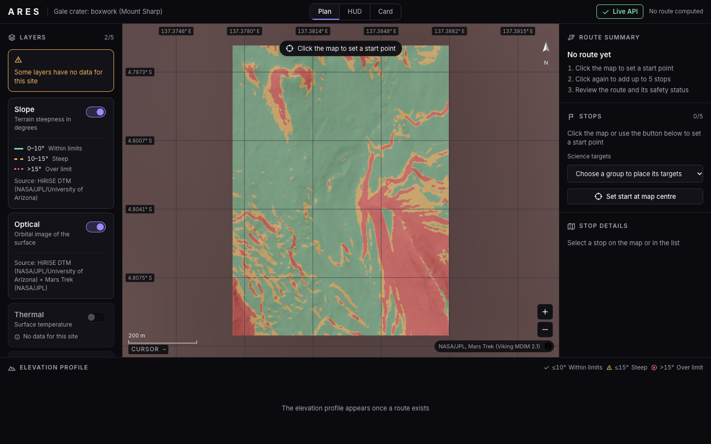
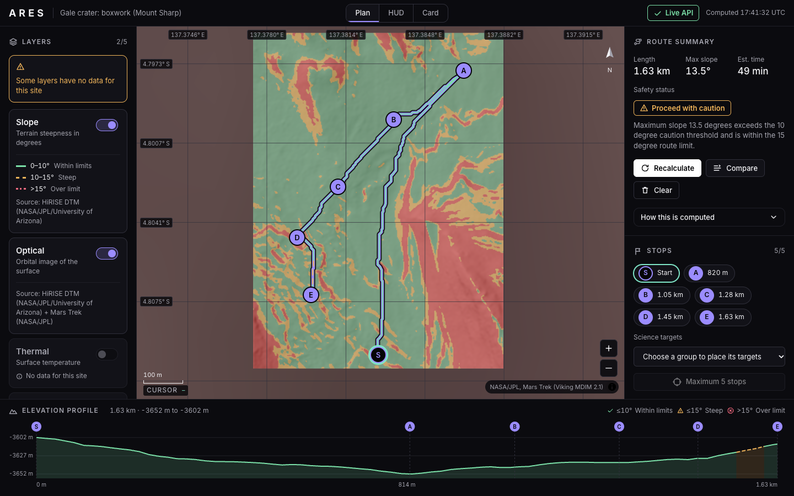
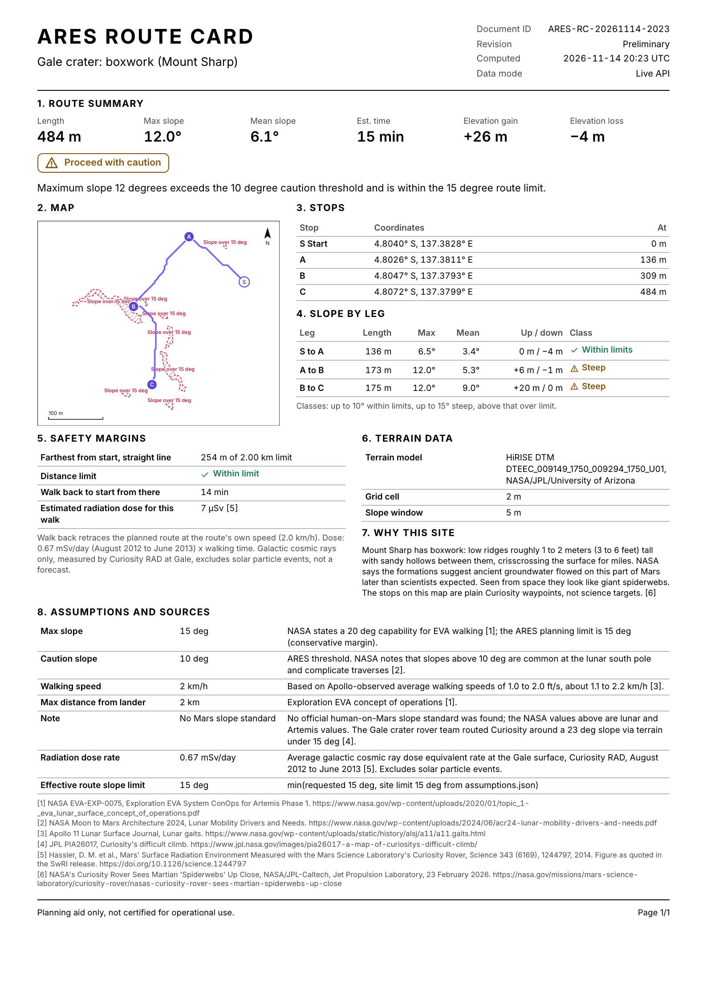

# NASA Space Apps - ARES

> NASA Space Apps Challenge 2026 project. **ARES plans a walking route for a person on foot on Mars: it keeps the route within slope limits and shows how long the walk back takes.**

**Live demo: https://aresmars.us/app**

| Plan: the whole site, slope and hillshade | Plan: a route through the Boxwork targets | Card: printable A4 route card |
|---|---|---|
|  |  |  |

## Problem

A person walking on Mars needs a route that respects slope limits and a safe way back. Satellite images show terrain, but not whether a given line across it is walkable, how steep each stretch is, or how far from the start the walk goes.

## Solution

ARES plans a Marswalk route at Gale crater (boxwork, Mount Sharp):

- **Terrain.** A 2 m grid of elevation and slope built from a HiRISE digital terrain model (DTM).
- **Routing.** The backend runs A* over the slope grid (8 neighbours). A cell steeper than the slope limit cannot be crossed. The route goes from a start through up to 5 stops.
- **Limits with sources.** The slope limits, walking speed and maximum distance from the start are listed with their sources in `backend/data/gale-bx/assumptions.json`. They cite NASA and JPL documents [1] to [5], also listed in `frontend/src/config/references.ts`.
- **Four views** in the web app. The app opens on the Mars overview; a link with a plan or a site (`#s=...`, `?site=...`) opens the planner instead:
  - **Mars:** the whole planet on the Viking mosaic, with markers for the ARES sites, mission landing sites and landmarks, a legend with layer toggles and an optional globe view. An ARES marker opens the planner on that site. The Mars button is always in the top bar.
  - **Plan:** map with the layers that have data (slope, hillshade over Mars imagery, thermal), stops, route summary with the estimated radiation dose of the walk and an elevation profile. The right column holds only the route; an icon rail on the left opens Layers, Sites, Site conditions (space weather and model climate) and "Method and sources" beside the map. Layers without data are marked "No data for this site".
  - **Plan** also has a Fast / Balanced / Safe route profile, a GO / CAUTION / NO-GO mission status, the round trip with the way back, climb and descent, a slope-class bar, a slope-limit sensitivity table (10, 15 and 20 degrees), a Mars weather card from Curiosity's REMS station when the backend has it, GeoJSON export of the route, and an optional "Full drive path" overlay of the whole Curiosity drive.
  - **HUD:** a heads-up view with compass, next stop and slope. The position moves with a slider (simulated).
  - **Card:** a printable one-page A4 route card with the map, stops, slope by leg, safety margins, the estimated radiation dose and the sources.

## Data and sources

From `backend/data/gale-bx/meta.json` and `sources.json`:

- **Terrain:** HiRISE DTM `DTEEC_009149_1750_009294_1750_U01`, NASA/JPL/University of Arizona. The grid cell is 3 m and each slope is measured over a 6 m window (a central difference between neighbouring cells; see `docs/DATA_CONTRACT.md`, section 4).
- **Imagery:** Viking MDIM 2.1 colour mosaic through NASA/JPL Mars Trek, used as the map basemap.
- **Science stops:** Curiosity (MSL) waypoints, NASA/JPL, `https://mars.nasa.gov/mmgis-maps/MSL/Layers/json/MSL_waypoints.json` (snapshot in `docs/research/r0/`).
- **Thermal:** USGS Astrogeology "Gale Crater THEMIS Daytime IR ISIS", NASA/JPL-Caltech/Arizona State University (Mars Odyssey THEMIS). A single 2007 observation, 100 m per pixel, drawn as blocks; stretched 8-bit values, not calibrated temperature.
- **Radiation:** average galactic cosmic ray dose equivalent rate of 0.67 mSv per day at the Gale surface (August 2012 to June 2013), measured by Curiosity RAD: Hassler et al., Science 2013, https://doi.org/10.1126/science.1244797. The dose of a walk is this rate times the walking time; galactic cosmic rays only, not a forecast.
- **Slope and walking limits:** documents [1] to [5]; see `ASSETS.md` for links, licenses and where each source is used.

## Limitations

- Two sites, both preliminary (`"preliminary": true` in `meta.json`). The Gale boxwork site has the Curiosity waypoints as stops; the second site (HiRISE DTM `DTEEC_001488_1750_001752_1750_U02`, no rover positions inside it) has terrain only: no stops and no description, because no verified source for that area was found. The grids and the stops need review by the science team.
- The HUD position comes from a slider. There is no live position feed.
- Layers without data show "No data for this site".
- The NASA slope values are lunar and Artemis values. No official human-on-Mars slope standard was found; the 15 degree limit and the 10 degree caution threshold are ARES planning values.
- The science stops are Curiosity waypoints, not curated science targets, and a group is limited to 5 stops.
- ARES is a hackathon project. It is not affiliated with NASA and is not certified for operational use.

## Run it locally

You need three things installed: **Python 3.10+** (the deployment uses 3.12), **Node.js 22.18+** (the frontend tests run `.ts` files directly; tested on Node 24) and **git**. No API keys and no data download are needed: the processed Gale grid is committed in `backend/data/gale-bx/` and `frontend/public/data/gale-bx/`.

```bash
git clone https://github.com/Arthurmyn/nasa-space-apps-ares.git
cd nasa-space-apps-ares
```

**1. Backend** (terminal 1)

macOS / Linux:

```bash
cd backend
python3 -m venv .venv
source .venv/bin/activate
pip install -r requirements-dev.txt     # requirements.txt is enough to run; -dev adds test tools
uvicorn app.main:app --reload
```

Windows (PowerShell):

```powershell
cd backend
python -m venv .venv
.venv\Scripts\Activate.ps1               # in cmd.exe: .venv\Scripts\activate
pip install -r requirements-dev.txt
uvicorn app.main:app --reload
```

Check it: http://localhost:8000/api/v1/health (JSON with `data_loaded: true`) and http://localhost:8000/docs (Swagger).

**2. Frontend** (terminal 2)

```bash
cd frontend
npm install
npm run dev
```

Open **http://localhost:5173/app/** (note the `/app/` path: it is the Vite `base`). The frontend talks to the backend at `http://localhost:8000` by default.

**No backend?** Run the frontend on built-in sample data (dev server only; a "Sample data" badge is shown and the terrain is synthetic):

```bash
VITE_USE_MOCK=true npm run dev          # PowerShell: $env:VITE_USE_MOCK="true"; npm run dev
```

**Optional settings.** Defaults work without any file. To change them, copy `.env.example` to `.env` in the repository root:

- `CORS_ORIGINS`: browser origins the backend accepts, comma separated (default `http://localhost:5173`). Set it if the frontend runs on another port.
- `VITE_API_URL`: where the frontend finds the backend (default `http://localhost:8000` in development; empty means same origin).

**Your first route**

1. Open the **Plan** tab. The whole Gale boxwork site is on the map.
2. Click the map to set the start, then click up to 5 stops. Or pick a group such as "Boxwork" under "Science targets" and then click a start.
3. Read the route summary: length, maximum slope, time, safety status, estimated radiation dose and the elevation profile. Open "Method and sources" on the left rail for the assumptions and sources.
4. Open **HUD** (compass, next stop and slope; the position moves with a slider) and **Card**, then press "Print or save as PDF" for the one-page A4 route card.

## Run the tests

```bash
cd backend && pytest
cd frontend && npm run lint && npm test && npm run build
```

## Docker (optional, not verified)

`docker compose up --build` is meant to start both services (frontend at http://localhost:5173/app/, backend at http://localhost:8000). It was not run while writing this README because no Docker daemon was available, so treat it as untested. The local steps above are the supported way to run the project.

```bash
cp .env.example .env
docker compose up --build
```

## Architecture

```
┌────────────┐   HTTP/JSON   ┌────────────┐   read at startup   ┌─────────────────┐
│  frontend  │ ────────────▶ │  backend   │ ──────────────────▶ │ data/gale-bx/   │
│ React+Vite │               │ FastAPI/A* │                     │ terrain, stops  │
└────────────┘               └────────────┘                     └─────────────────┘
     :5173                        :8000                        backend/data/
```

| Layer | Stack | Folder |
|-------|-------|--------|
| Frontend | React 18, TypeScript, Vite, MapLibre GL | [`frontend/`](frontend/) |
| Backend | Python 3.10+, FastAPI, Pydantic, numpy; Docker uses Python 3.12 | [`backend/`](backend/) |
| Infra | Docker Compose, Caddy, GitHub Actions deploy to a VPS | [`deploy/`](deploy/), [`docker-compose.yml`](docker-compose.yml), [`.github/`](.github/) |

More in [docs/architecture.md](docs/architecture.md); the API contract is in [docs/api.md](docs/api.md) and the data contract in [docs/DATA_CONTRACT.md](docs/DATA_CONTRACT.md).

## Project structure

```
nasa-space-apps-ares/
├── .github/                # PR and issue templates
├── docs/                   # architecture, API and data contracts, task board, research notes
├── frontend/               # web app (React + Vite + TypeScript)
│   ├── src/api/            # API client and response validation
│   └── public/data/        # site grid images and metadata served to the browser
├── backend/                # API (FastAPI)
│   ├── app/api/routes/     # endpoints
│   ├── app/core/           # settings
│   ├── app/schemas/        # Pydantic models (the API contract)
│   ├── app/services/       # grid loading, A* routing, hazard zones
│   ├── data/gale-bx/       # processed terrain grid, stops, assumptions
│   └── tests/
├── landing/                # project page
├── scripts/                # data scripts (slope grid, thermal layer) and GitHub setup
├── ml/                     # unused template, not part of the product
└── docker-compose.yml
```

## Team

| Name | Role | GitHub |
|------|------|--------|
| Aikyn Sagyntai | Team lead | [@mathalama](https://github.com/mathalama) |
| Artur Jaxygaliyev | Full Stack, Data Analyst | [@arthurmyn](https://github.com/Arthurmyn) |
| Alikhan Korazbay | Research Engineer | [@Alikhan](https://github.com/alikshal) |
| Berdibek Amir | Visual, GEN AI | [@Berdibek](https://github.com/berdibekGTX) |


## Contributing

Every piece of work starts as a **GitHub issue**: state the goal, the expected result, the subtasks and the definition of done, and split a big task into issues with a checkable result. See [CONTRIBUTING.md](CONTRIBUTING.md) for branches, commits, pull requests and review, and [how to write and split issues](CONTRIBUTING.md#4-tasks-issues-and-board).

## License

[Apache License 2.0](LICENSE), see also [NOTICE](NOTICE).
